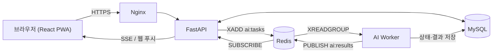

# Pair 2 Care — 파이널 프로젝트 한눈에 보기 (OZ 2조)

> 마지막 정리: 2026-11-20 (5장 기술 선정 이유·6장 데이터 흐름 추가, 미정 사항 갱신)  
> 결정이 바뀌면 이 문서부터 고침. 세부 내용은 각 섹션의 링크 문서 참고.

## 1. 개요
- 서비스·팀 이름: **Pair 2 Care** (페어 투 케어, 11/16 확정) — 레포 https://github.com/AI-HealthCare-07/pair2care
- 과정: OZ 코딩스쿨 Digital Healthcare AI Web Service Project
- 주제: 만성질환(고혈압·당뇨 등) 생활습관 챌린지 웹 서비스 — 출제 기업 Talos (원문 [topic_talos.md](topic_talos.md))
- 범위: 기획·데이터 수집 → 모델 학습 → 서빙 → 풀스택 웹 → AWS 배포까지 팀이 직접 구현함
- 평가 포인트: "구체적 사용자 문제 → AI로 푸는 지점" 설계, Git Flow·코드리뷰·이슈 관리

## 2. 기능 범위 (선택 기능까지 전부 구현하기로 함)

| 구분 | 기능 | 핵심 |
|---|---|---|
| 필수 | 만성질환 예측 모델 | 공개 데이터(Kaggle·AIHub·HuggingFace)로 발병 가능성 예측 |
| 필수 | 추적 대시보드 | 사용자 입력·설문 데이터 시각화, 위험도 변화 추이 |
| 필수 | 생활습관 챌린지 | 걸음 수·물·운동 등 자유 구현 |
| 선택 | LLM 예방 행동 추천 | 건강·행동 데이터 기반 일일 맞춤 추천 |
| 선택 | 식단 이미지 분류 | 사진 → 음식 분류 → 부족 영양소 피드백 |
| 선택 | 알림 | 입력·챌린지 체크·가이드 확인 알림 |

- 이름에 맞춰 **짝꿍 챌린지**(둘이 짝지어 서로 인증 확인·응원)를 챌린지 핵심 기능으로 넣는 방향 제안 — "혼자 하면 작심삼일" 문제 정의와 연결
- 서비스 흐름: 설문·기록 입력 → 예측 위험도 → 대시보드 추이 → 챌린지로 습관 개선 → 다시 입력해서 위험도 변화 확인
- 모델 입력은 **사용자가 앱에서 직접 입력할 수 있는 값**이어야 함 (혈액검사 수치 위주 데이터는 추이를 못 그림 → 설문 기반 데이터셋 우선)

## 3. 일정

| 스프린트 | 기간 | 내용 |
|---|---|---|
| S1 | 11/16 ~ 11/22 | 기획 문서 4종·와이어프레임 (팀 목표: 11/20 금 완료) |
| S2 | 11/23 ~ 11/29 | 기능 구현 / 11/27(금) 빈 껍데기 테스트 배포(팀 자체 목표, 11/17 확정) |
| S3 | 11/30 ~ 12/6 | 기능 구현 / 12/4(금) 핵심 흐름 테스트 배포(팀 자체 목표 — 가입·예측·챌린지·대시보드·짝꿍 초대) |
| S4 | 12/7 ~ 12/13 | 고도화 / LLM 추천 완성 |
| S5 | 12/14 ~ 12/20 | 고도화 / 식단 분류·알림, 12/20 기능 동결(제안) |
| S6 | 12/21 ~ 12/28 | 배포·QA·성능 개선 (12/25 크리스마스) |
| S7 | 12/29 ~ 12/30 | 발표 준비 |

- **12/29(월) 결과 제출 마감**, 12/30(수) 데모데이, 2027-01-04 취업 컨설팅·수료식(필수)
- 특강: RAG 11/18 10~14시 / 바이브코딩 11/23 / Talos 기업 12/7 / 이력서·자소서 12/31 (RAG 외 시간은 미정, 11/17 기준)
- 세션: 초기 세팅 11/20 / 배포 12/21

## 4. 제출물
- 기획 문서 4종: 요구사항 정의서, 와이어프레임(Figma), ERD·테이블 명세서, API 명세서
- GitHub 레포 (Public, 6개월 유지)
- 배포 URL (프론트·백 분리 시 각각)
- 발표자료 PPT + PDF, 회사명 "넥스트러너스" 포함

## 5. 기술 스택·선정 이유
> 참여기업 평가 2-1(선택 이유 + 대안 비교) 대비. 템플릿이 정해 준 것과 팀이 고른 것을 구분함

| 영역 | 선택 | 고른 이유 | 비교한 대안 · 안 고른 이유 |
|---|---|---|---|
| 백엔드 | FastAPI (Python 3.13, uv) | 공식 템플릿 기준. 비동기 I/O로 DB·Redis·외부 API 대기 중 다른 요청 처리, Swagger 자동 생성으로 프론트와 명세 공유 | Django — 동기 기본이라 SSE·LLM 호출 대기에 불리, 템플릿과도 다름 |
| ORM | Tortoise ORM + aerich | 템플릿 기준. FastAPI와 같은 async 방식, aerich로 마이그레이션 이력 관리 | SQLAlchemy async — 표현력은 높지만 설정·코드량이 많음 |
| DB | MySQL 8.0 | 템플릿 기준. 회원·챌린지·짝꿍처럼 관계가 많은 데이터 → 관계형 + FK 제약으로 짝꿍 중복 등 무결성 보장 | NoSQL — 관계·트랜잭션이 많아 부적합 |
| 큐·캐시 | Redis (Stream · Pub/Sub · 키 만료) | 하나로 작업 큐(Stream + Consumer Group, 실패 재처리 XAUTOCLAIM)·결과 알림(Pub/Sub)·만료 데이터(SSE 티켓 30초, 비번 찾기 인증번호 10분, 로그인 잠금)를 다 처리 | Celery + RabbitMQ — 컨테이너가 늘고 Redis는 어차피 필요. Kafka — 이 규모엔 과함 |
| 실시간 전달 | SSE + 웹 푸시 | 서버 → 브라우저 한 방향 알림이면 충분, HTTP 그대로라 nginx·인증 설정이 단순. 앱을 닫았을 땐 웹 푸시 | WebSocket — 양방향이 필요 없음. 폴링 — 요청 낭비, 결과가 늦게 보임 |
| 프론트 | React + Vite (모바일 PWA) | 팀 학습 목표 + 컴포넌트 재사용(피그마 컴포넌트와 1:1). Vite는 빌드·개발 서버가 빠름. 홈 화면 앱(PWA)으로 앱 설치 없이 사용 | Next.js — SSR·SEO가 필요 없는 로그인 후 서비스라 이점 적음. 네이티브 앱 — 6주 일정에 무리 |
| 위험 예측 | 로지스틱 회귀 (비교 모델 XGBoost) | 가벼워서 FastAPI에서 바로 추론(REQ-PRED-001), 계수로 "어떤 요인이 위험을 올렸는지"(factors) 설명 가능 → 의료 서비스에 필요한 설명력 | XGBoost·LightGBM — 같은 표로 성능 비교(REQ-NFR-014), 설명력·서빙 단순성에서 회귀 우선 |
| 식단 분류 | DINOv3 ViT-S/16 백본 고정 + 선형 헤드 (한식 18종) | 적은 데이터(5,383장)로도 사전학습 특징이 좋아 학습이 빠름, 워커에서 비동기 추론 | 비전 LLM API — 호출 비용·지연, 보조로만 검토 중(api.md 정할 것 21번). 비전 언어 모델 Gemma 4 E2B 제로샷 — 같은 테스트 539장 top-1 0.186 vs 0.853(11/20 백본 비교) |
| LLM 추천 | Claude API (개발 Haiku · 배포 Sonnet) + RAG (공인 가이드 근거) | 근거 문서 안에서만 답하게 해 의료 표현 안전성 확보(REQ-NFR-002), 프롬프트 캐싱으로 비용 관리(REQ-NFR-011) | 파인튜닝 LLM — 데이터·기간 부족. 근거 없이 생성 — 안전성 문제 |
| 결과지 OCR (12/4 이후) | CLOVA OCR → 정규식 후처리 → 경량 LLM 형식 맞춤 | 한글 인식률, 좌표로 항목 매칭, 사용자 확인 후 저장(REQ-PROF-003) | LLM만으로 읽기 — 수치 오인식 위험 |
| 배포 | AWS EC2 + Docker Compose (nginx / fastapi / redis / ai-worker / mysql) | 과정 제공 환경이 EC2, 로컬과 같은 compose로 배포 차이 최소화 | ECS·k8s — 6명·6주 규모엔 운영 부담 큼. S3는 사용 가능 여부 문의 중 |

- 공식 템플릿 `OZ-Coding-School/AI_HealthCare_Final_Project_Template` 기반
- 규칙 전체: [../CLAUDE.md](../CLAUDE.md) · 로컬 세팅: [setup_로컬세팅.md](setup_로컬세팅.md)

## 6. 데이터 흐름
> 참여기업 평가 1-3(데이터 흐름 포함) 대비. 기준: [api.md](api.md) 1장 공통 규칙·12-6, CLAUDE.md 워커 구조

### 6-1. 전체 구성

### 6-2. 바로 끝나는 요청 (동기) — 예: 가입 설문 저장
1. 브라우저 → `POST /api/v1/health-profiles` (JWT)
2. FastAPI: 입력 범위 검증 → `health_profiles` 저장 → 예측 서비스 호출(로지스틱 회귀, 수 ms) → `risk_predictions` 저장
3. 응답에 위험도 포함 → 대시보드 추이는 `risk_predictions` 이력으로 그림

### 6-3. 오래 걸리는 요청 (비동기) — 예: 식단 사진 분류, LLM 추천
1. 브라우저 → `POST /api/v1/meals` (사진) → FastAPI가 `meals` 행을 `PENDING`으로 만들고 **바로 `202 + task_id`** 응답
2. FastAPI → Redis Stream `ai:tasks`에 `{task_id, task_type, user_id, target_id}` XADD
3. AI Worker(Consumer Group) → 꺼내서 분류·LLM 실행 → DB에 결과·상태(`COMPLETED`/`FAILED`) 직접 저장
   - 실패하면 1초·2초 쉬고 최대 3번, 그래도 실패면 dead-letter(`ai:tasks:dead`)
   - 워커가 죽어 멈춘 작업은 5분 뒤 다른 워커가 가져감(XAUTOCLAIM)
4. Worker → Pub/Sub `ai:results`에 "끝남" 알림 → FastAPI가 받아 그 사용자의 **SSE 연결로 `task` 이벤트** 전송
5. 브라우저 → 이벤트를 받으면 `GET /api/v1/meals/{id}`로 결과 조회 (사이트가 닫혀 있으면 웹 푸시)

### 6-4. 짝꿍에게 가는 데이터
- 짝꿍 API 응답에는 **닉네임 + 날짜별 완료 여부(`checked_on`)만** 들어감. 건강 수치·위험도·검진·기록은 어떤 경로로도 안 감 (REQ-PAIR-003)

### 6-5. 저장 위치 요약
| 데이터 | 저장 | 보관 |
|---|---|---|
| 회원·설문·검진·예측·기록·챌린지·식단·알림 | MySQL | 탈퇴 시 건강정보 즉시 삭제 (api.md 2-8) |
| 작업 큐·결과 알림 | Redis Stream / Pub/Sub | 처리 후 ACK, 실패분만 dead-letter (최근 1,000건) |
| SSE 티켓·비번 찾기 인증번호·로그인 실패 횟수 | Redis 키 | 30초 / 10분 / 10분 뒤 자동 삭제 |
| 식단 사진 | `meals.image_url` (위치는 S3 답변 후 결정) | — |
| 로그 | 컨테이너 로그 | 건강 정보는 로그에 안 남김 (REQ-NFR-006) |

## 7. 팀
- 팀장: 김지연 / 팀원: 여현지, 이지희, 장성은, 김민준, 최현영 (6명)
- 1차 분담(11/16): 김지연 프론트·백엔드(+프론트 초기 세팅·SSE 연결·배포) / 이지희 백엔드 / 김민준·장성은 AI / 여현지 AI·프론트 / 최현영 미정
- 11/17 회의: 여현지 식단 이미지 책임자, 최현영 AI·백엔드 겸함
- 방향: 초반 AI 3명(예측·LLM·식단 이미지), 예측 담당은 S3에 백엔드로 이동
- 상세: [team.md](team.md)

## 8. 협업 규칙
- Daily Scrum 평일 10:10, 15분 (전일 진행 / 금일 예정 / 안건, 해결은 스크럼 뒤 따로)
- Git Flow: `main`(보호) ← `develop`(기본) ← `feature/*`, PR 리뷰 1명 후 merge
- 주 1회 멘토링 — 사전 보고서 [mentoring/week1_사전보고.md](mentoring/week1_사전보고.md)
- KPT 회고(노션, 매주 금): Keep·Problem → Try(SMART) → 투표로 Action Item 2~3개

## 9. 미정 사항 (팀 회의 안건)
- [x] 서비스 이름 → Pair 2 Care
- [x] 최현영 트랙 — AI·백엔드 겸함 (11/17)
- [x] 역할 분담 — 예측 학습·검증 장성은 / 서빙 최현영, LLM 김민준, 식단 여현지, 챌린지·짝꿍 이지희 (11/20, [team.md](team.md))
- [x] 식단 이미지 책임자 — 여현지 (11/17)
- [x] 식단 이미지 분류 방식 → DINOv3 백본 고정 + 선형 헤드 학습, 비전 LLM은 보조로 검토 중 (11/19)
- [x] 대상 질환 → 고혈압·당뇨 둘 다
- [x] 타깃 사용자 → 30~60대 일하는 시간이 불규칙한 사람, 정상~경계 단계 (11/17)
- [ ] 문제 정의 한 줄
- [x] 서비스 입구 → 가입 중 설문·수치 둘 다(수치 선택), 가입 후 수정 가능 (11/17)
- [x] 짝꿍 챌린지 필수, 완료 여부만 공유 (11/17)
- [x] 결과지 OCR → 12/4 이후 김지연 (11/18)
- [x] 예측 대상 → 고혈압·당뇨 각각 모델, 대사증후군은 검진 수치 기준표로 판정 (11/18~19)
- [x] 프론트 방식 → React + Vite (11/17)
- [x] 레포 → org `AI-HealthCare-07/pair2care` (Public), 팀원 Write 권한 5명 전원 추가 (11/17 완료)
- [ ] S3 사용 가능 여부 (제공 목록엔 EC2만 있음)
- [x] Daily Scrum → 평일 10:10
- [x] 회고 요일 → 금요일 (11/17)
- [x] 조기 배포 → 11/27 빈 껍데기, 12/4 핵심 흐름 (11/17)

## 10. 이번 주 할 일
- [x] 월: 이름·주제·1차 분담 회의, 레포 생성, 템플릿 첫 커밋
- [x] 화까지 숙제: 팀원 모두 가상 사용자 2명(고혈압 1, 당뇨 1) — 누구·건강 상태·불편한 점·기존 방법이 안 되는 이유·사용 순간·필요 기능 6칸 → 6명 전원 [personas_원문/](personas_원문/README.md), 종합 [personas.md](personas.md)
- [x] 화: 요구사항 정의서 완성 (`REQ-USER-001` 형식) → [requirements.md](requirements.md)
- [x] 수: RAG 특강 후 와이어프레임·ERD 시작
- [x] 목: 와이어프레임·ERD 마무리, API 명세서 → [wireframe.md](wireframe.md)·피그마, [erd.md](erd.md), [api.md](api.md) (11장 LLM 11/20 #56)
- 금 (11/20)
  - [x] 4종 교차 확인 → v1 확정 (#49·#52·#56·#57)
  - [ ] 초기 세팅 세션 → 팀원 clone·env·`docker compose up` 확인 — 3/6 (김지연·여현지·장성은), ai-worker 실행은 #54 머지로 가능
  - [x] 브랜치 보호 — ruleset으로 `main`·`develop` 보호 (PR 필수, 삭제·강제 push 금지)
  - [x] 사전 보고서 → [mentoring/week1_사전보고.md](mentoring/week1_사전보고.md)
  - [ ] 첫 회고 (노션 KPT)
