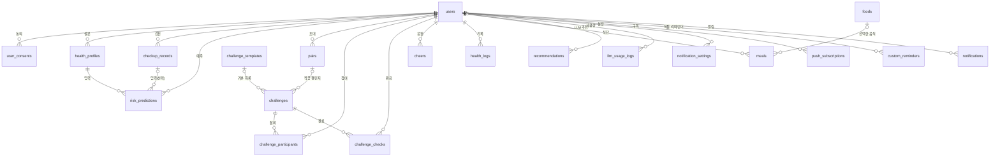

# ERD·테이블 명세서 (초안)

> 상태: **테이블 목록 초안** — 11/17 작성, 11/19 컬럼 초안 → 11/20 교차 확인  
> 기준: [requirements.md](requirements.md)의 `REQ-*`. 컬럼은 후보이고 담당자가 확정함  
> 담당: 김지연 · 이지희
> 컬럼은 [erd.dbml](erd.dbml)에 채움 → [dbdiagram.io](https://dbdiagram.io)에 붙여넣으면 그림으로 보임. 완성되면 PNG로 내보내서 여기 붙임

## 1. 공통 규칙
- 테이블명은 snake_case 복수형 (`users`, `health_logs`)
- PK는 `id` (BigInt), FK는 `<대상>_id` (예: `user_id`)
- 모든 테이블에 `created_at`, 수정되는 테이블에만 `updated_at`도 둠 (기록용 테이블은 `created_at`만, 11/17 확정)
- 이름: 불리언은 `is_`로 시작, 날짜+시간은 `_at`, 날짜만은 `_on` (예: `checked_on`), enum 값은 대문자 (11/17 확정)
- 시간은 한국 시간(KST)으로 저장 (11/17 확정)
- 삭제: 회원 탈퇴 시 개인정보(이메일·닉네임 등)는 지우고 나머지는 표시만 하는 방향 (11/17, 세부는 구현 때 정함)
- 고정된 선택지는 CharEnum (예: `status`, `log_type`), 값 목록은 이 문서에 적음
- 형태가 자주 바뀌는 결과(예측 요인, 음식 후보 상위 5개, 영양소, 근거 출처)는 JSON 컬럼
- 개인 건강정보는 로그에 남기지 않음. 짝꿍에게 보이는 건 `challenge_checks`의 완료 여부뿐임 (`REQ-PAIR-003`)
- 템플릿 `users`에서 `phone_number`는 뺌 (11/17 결정, 비밀번호 찾기는 이메일 재설정 링크 `REQ-USER-004`)

## 2. 테이블 목록

### 회원·건강 프로필 — 김지연
| 테이블 | 설명 | 주요 컬럼 (후보) | 관련 REQ |
|---|---|---|---|
| `users` | 회원 (템플릿 있음, `phone_number` 제거, 실명 대신 닉네임) | email, hashed_password, nickname, gender, birthday | USER-001~004 |
| `user_consents` | 약관·개인정보·민감정보 동의 기록. 동의·철회할 때마다 행을 쌓고, 현재 상태는 종류별 최신 행 | user_id, agreement(TERMS/PRIVACY/SENSITIVE_HEALTH), version, is_agreed, created_at | USER-005 |
| `health_profiles` | 생활습관 설문 응답. 재설문마다 새 행으로 쌓음 | user_id, 설문 항목들(**11/18 데이터팀 입력 변수 확정 후**), answered_at | PROF-001, PRED-004 |
| `checkup_records` | 검진 수치. 집에서 잰 기록과 따로 둠 | user_id, systolic, diastolic, fasting_glucose, waist_cm, checked_on, source(manual/ocr) | PROF-002, PROF-003 |

### 예측 — 김지연
| 테이블 | 설명 | 주요 컬럼 (후보) | 관련 REQ |
|---|---|---|---|
| `risk_predictions` | 위험도 계산 결과. 추이 그래프의 원천 | user_id, health_profile_id, checkup_record_id(null 가능), disease, score, level, factors(JSON), model_version | PRED-001~004, DASH-003 |

### 챌린지·짝꿍 — 이지희
| 테이블 | 설명 | 주요 컬럼 (후보) | 관련 REQ |
|---|---|---|---|
| `challenge_templates` | 기본 제공 챌린지 목록 (걷기·물·절주 등) | title, category, default_times_per_week | CHAL-001 |
| `challenges` | 만든 챌린지. 짝꿍 챌린지면 `pair_id` 있음 | created_by, challenge_template_id, pair_id(null 가능), title, times_per_week, starts_on, ends_on, status | CHAL-001, PAIR-002 |
| `challenge_participants` | 챌린지 참여자 (개인 1명, 짝꿍 2명) | challenge_id, user_id, joined_at | PAIR-002 |
| `challenge_checks` | 날짜별 완료 체크. 연속 달성·달성률 계산 | challenge_id, user_id, checked_on (challenge_id+user_id+checked_on 유니크) | CHAL-002~003, PAIR-003 |
| `pairs` | 짝꿍 관계 | requester_id, partner_id(null 가능), invite_code, status(pending/accepted/ended), accepted_at | PAIR-001 |
| `cheers` | 응원 | from_user_id, to_user_id, challenge_id, message | PAIR-004 |

### 건강 기록 — 이지희
| 테이블 | 설명 | 주요 컬럼 (후보) | 관련 REQ |
|---|---|---|---|
| `health_logs` | 집에서 잰 혈압·혈당, 음주, 운동량(걸음 수), 컨디션. 한 테이블에 `log_type`으로 구분 | user_id, log_type, value, value2(이완기 혈압 등), unit, measured_at, memo | DASH-001~002, DASH-005 |

### 식단 — 이지희 (여현지 확인)
| 테이블 | 설명 | 주요 컬럼 (후보) | 관련 REQ |
|---|---|---|---|
| `foods` | 식약처 영양 DB에서 가져온 음식 (분류 클래스 30~50개와 1:1) | name, serving_g, kcal, carbs_g, sugar_g, sodium_mg, protein_g, fat_g | FOOD-002 |
| `meals` | 식단 사진 기록. 분류는 워커가 비동기로 채움 | user_id, image_url, eaten_at, status(pending/done/failed), candidates(JSON 상위 5개), food_id(사용자 선택), portion(0.5/1/1.5), nutrients(JSON) | FOOD-001~003 |

### LLM — 김지연 (김민준 확인)
| 테이블 | 설명 | 주요 컬럼 (후보) | 관련 REQ |
|---|---|---|---|
| `recommendations` | LLM 결과 저장. 하루 1번 생성하고 화면은 저장본을 보여줌 | user_id, rec_type(daily/menu/weather/explain/weekly), target_date, content, sources(JSON), status, model | LLM-001~005, NFR-002 |
| `llm_usage_logs` | 기능별 토큰 사용량 | user_id(null 가능), feature, model, input_tokens, output_tokens, cache_read_tokens | NFR-012 |

### 알림 — 김지연
| 테이블 | 설명 | 주요 컬럼 (후보) | 관련 REQ |
|---|---|---|---|
| `notification_settings` | 알림 종류별 켜기·요일·시간, 방해 금지 시간 | user_id, noti_type, is_enabled, days(JSON), notify_at, quiet_start, quiet_end | NOTI-001 |
| `push_subscriptions` | 웹 푸시 구독 정보 (기기마다 1행) | user_id, endpoint, p256dh, auth, user_agent | NOTI-003 |
| `custom_reminders` | 사용자가 직접 만든 리마인더 (영양제·혈압 재기 등). 약 정보는 저장 안 함, `title`은 짝꿍에게 비공개 | user_id, title, days(JSON), remind_at, is_enabled | NOTI-009 |
| `notifications` | 보낸 알림 기록 (앱 안 알림 목록·읽음 표시) | user_id, noti_type, title, body, link(바로 이동할 화면), is_read, sent_at | NOTI-002, NOTI-004~007 |

> 총 20개 (김지연 11 · 이지희 9, 김지연은 공통 규칙·합치기 추가). 비동기 작업 상태는 별도 테이블 없이 `meals.status`, `recommendations.status`로 관리하는 안

## 3. 관계 한눈에 보기

## 4. 분담·일정

### 김지연
- 공통 규칙(1번) 확정, 전체 관계도 관리, 최종 합치기
- 회원·프로필·예측·LLM·알림 테이블 컬럼 확정
- API 명세와 테이블·필드 이름 맞추기

### 이지희
- 챌린지·짝꿍·건강 기록·식단 테이블 컬럼 확정
- 짝꿍 공개 범위(완료 여부만)가 조회 쿼리에서 지켜지는지 확인

### 일정
- 11/18(수) 오후: 각자 맡은 테이블 컬럼·타입·NULL 여부 작성
- 11/19(목) 오전: 김지연이 합쳐서 관계도 갱신
  - `health_profiles` 컬럼 → 데이터팀(장성은·김민준·최현영) 확인
  - `foods`·`meals` → 여현지 확인, `recommendations` → 김민준 확인
- 11/20(금): 기획 4종 교차 확인

## 5. 정할 것
- [x] `users.phone_number` → 뺌 (11/17). 비밀번호 재설정 토큰은 테이블 대신 Redis에 만료 시간으로 두는 안
- [ ] 예측 대상에 따라 `risk_predictions.disease` 값 (고혈압·당뇨 각각 vs 대사증후군)
- [x] 짝꿍은 한 사람당 여러 명 가능 (11/17). 같은 두 사람 사이 짝꿍은 하나만
- [ ] 짝꿍 해제 시 진행 중인 짝꿍 챌린지 처리 — 해제할 때 "종료"와 "개인 챌린지로 계속" 중 고르게 하는 안, 문구 정하기
- [x] `challenge_checks` 중복 기준 — (챌린지, 사용자, 날짜) 유니크. 다른 챌린지는 같은 날 각각 체크 가능 (11/17)
- [ ] `health_logs`를 한 테이블로 둘지, 항목별로 나눌지
- [ ] 이미지 저장 위치 — 우선 `meals.image_url` 문자열로 두고 S3 답변 후 결정 (11/17)
