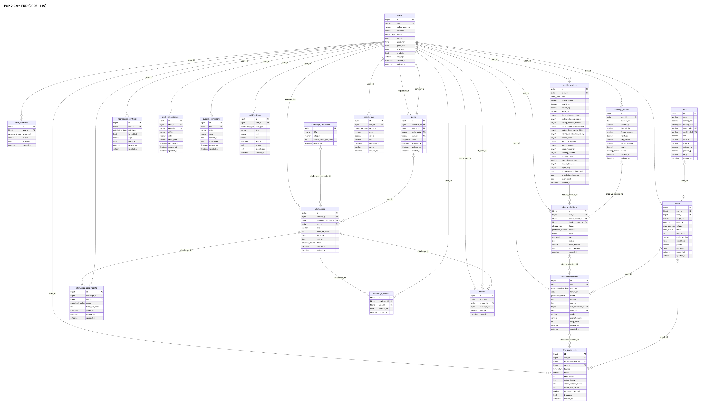
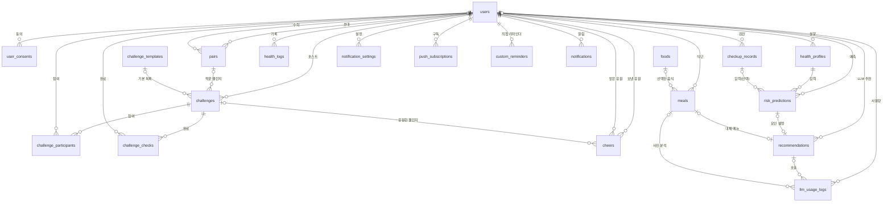

# ERD·테이블 명세서 (v1 확정)

> 상태: **v1 확정** — 11/17 작성, 11/19 컬럼 초안, 11/20 4종(요구사항·와이어프레임·ERD·API) 교차 확인 후 확정. 이후 변경은 PR로 하고 관련 문서도 같이 고침  
> 기준: [requirements.md](requirements.md)의 `REQ-*`. 컬럼 변경은 PR로 하고 api.md도 같이 고침  
> 담당: 김지연 · 이지희
> 컬럼은 [erd.dbml](erd.dbml)에 채움 → [dbdiagram.io](https://dbdiagram.io)에 붙여넣으면 그림으로 보임

> 그림은 11/18 기준이라 지금 컬럼과 다를 수 있음. 최신 컬럼은 [erd.dbml](erd.dbml)이 기준

## 1. 공통 규칙
- 테이블명은 snake_case 복수형 (`users`, `health_logs`)
- PK는 `id` (BigInt), FK는 `<대상>_id` (예: `user_id`)
- 모든 테이블에 `created_at`, 수정되는 테이블에만 `updated_at`도 둠 (기록용 테이블은 `created_at`만, 11/17 확정)
- 이름: 불리언은 `is_`로 시작, 날짜+시간은 `_at`, 날짜만은 `_on` (예: `checked_on`), enum 값은 대문자 (11/17 확정)
- 시간은 한국 시간(KST)으로 저장 (11/17 확정)
- 삭제: 회원 탈퇴 시 개인정보(이메일·닉네임 등)는 지우고 나머지는 표시만 하는 방향 (11/17, 세부는 구현 때 정함)
- 고정된 선택지는 CharEnum (예: `status`, `log_type`), 값 목록은 이 문서에 적음
- 형태가 자주 바뀌는 결과(예측 요인, 음식 후보 상위 5개, 영양소, 근거 출처)는 JSON 컬럼
- 개인 건강정보는 로그에 남기지 않음. 짝꿍에게 보이는 건 `challenge_checks`의 완료 여부뿐임 (`REQ-PAIR-003`)
- 템플릿 `users`에서 `phone_number`는 뺌 (11/17 결정, 비밀번호 찾기는 이메일 인증번호 `REQ-USER-004`, 11/19 링크에서 변경)

## 2. 테이블 목록

### 회원·건강 프로필 — 김지연
| 테이블 | 설명 | 주요 컬럼 (후보) | 관련 REQ |
|---|---|---|---|
| `users` | 회원 (템플릿 있음, `phone_number` 제거, 실명 대신 닉네임) | email, hashed_password, nickname, gender, birthday, quiet_start·quiet_end(방해 금지 시간, null이면 안 씀), is_active, is_admin, last_login | USER-001~004, NOTI-001 |
| `user_consents` | 약관·개인정보·민감정보 동의 기록. 동의·철회할 때마다 행을 쌓고, 현재 상태는 종류별 최신 행 | user_id, agreement(TERMS/PRIVACY/SENSITIVE_HEALTH), version, is_agreed, created_at | USER-005 |
| `health_profiles` | 생활습관 설문 응답. 재설문마다 새 행으로 쌓음 | user_id, kind, 신체·가족력·음주·흡연·진단 여부 20문항 (코드는 `survey-mapping.md`), is_pregnant(여성만, 예면 예측 안 함), created_at. 재설문에서 안 묻는 항목은 직전 값 복사(허리둘레는 빈칸), 상위 답이 바뀌면 하위 문항만 다시 물음 | PROF-001, PRED-004 |
| `checkup_records` | 검진 수치. 집에서 잰 기록과 따로 둠 | user_id, systolic_bp, diastolic_bp, fasting_glucose, waist_cm, triglyceride, hdl_cholesterol, hba1c(선택), checked_on, source(MANUAL/OCR) | PROF-002, PROF-003 |

### 예측 — 김지연
| 테이블 | 설명 | 주요 컬럼 (후보) | 관련 REQ |
|---|---|---|---|
| `risk_predictions` | 위험도 계산 결과. 추이 그래프의 원천 | user_id, health_profile_id, checkup_record_id(null 가능), disease(HYPERTENSION/DIABETES), method(MODEL/CHECKUP_CRITERIA), score(0~100 정수, 기준표 행은 null), level(LOW/CAUTION/HIGH), factors(JSON 상위 3개), model_version(`diabetes_risk:v1`, 기준표 행은 null), input_snapshot(JSON, 예측 시점 입력값) | PRED-001~004, DASH-003 |

### 챌린지·짝꿍 — 이지희
| 테이블 | 설명 | 주요 컬럼 (후보) | 관련 REQ |
|---|---|---|---|
| `challenge_templates` | 기본 제공 챌린지 목록 (걷기·물·운동·스트레칭·절주·체중·금연, 11/19 체중·금연 추가) | title, category, default_times_per_week | CHAL-001 |
| `challenges` | 만든 챌린지. 1:1 짝꿍 챌린지면 `pair_id` 있음, 1:N은 비움 | created_by(현재 호스트), challenge_template_id, pair_id(null 가능), title, times_per_week, starts_on, ends_on, status | CHAL-001, PAIR-002 |
| `challenge_participants` | 챌린지 참여자 (개인 1명, 1:1 짝꿍 2명, 1:N 2~4명) | challenge_id, user_id, status(INVITED/JOINED/LEFT), times_per_week(개인 목표, null이면 챌린지 값), joined_at(수락 시각) | PAIR-002 |
| `challenge_checks` | 날짜별 완료 체크. 연속 달성·달성률 계산 | challenge_id, user_id, checked_on (challenge_id+user_id+checked_on 유니크) | CHAL-002~003, PAIR-003 |
| `pairs` | 짝꿍 관계 | requester_id, partner_id(null 가능), invite_code, pair_key(작은 id:큰 id, unique), status(PENDING/ACCEPTED/ENDED), accepted_at | PAIR-001 |
| `cheers` | 응원 | from_user_id, to_user_id, challenge_id, message | PAIR-004 |

### 건강 기록 — 이지희
| 테이블 | 설명 | 주요 컬럼 (후보) | 관련 REQ |
|---|---|---|---|
| `health_logs` | 집에서 잰 혈압·혈당, 음주, 운동량(걸음 수), 컨디션, 주간 기록 6종(걷기·근력·앉은 시간·수면·아침식사·스트레스, 그 주 월요일 기준 1행). 한 테이블에 `log_type`으로 구분 | user_id, log_type, value, value2(이완기 혈압 등), unit, measured_at, memo | DASH-001~002, DASH-005 |

### 식단 — 이지희 (여현지 확인)
| 테이블 | 설명 | 주요 컬럼 (후보) | 관련 REQ |
|---|---|---|---|
| `foods` | 식약처 영양 DB에서 가져온 음식. 1차 학습 한식 18종과 1:1, 18종 값을 한 번 조회해서 넣음 (API 매번 호출 안 함) | name, serving_size, serving_unit(G/ML), kcal, carbs_g, sugar_g, sodium_mg, protein_g, fat_g(영양값은 null 허용), mfds_code(출처, unique), model_label(모델 클래스명, unique) | FOOD-002 |
| `meals` | 식단 사진 기록. 분류는 워커가 비동기로 채움 | user_id, image_url, eaten_at, category, status, retry_count, candidates(JSON), food_id(사용자 선택, null 가능), portion, nutrients(JSON), model_version | FOOD-001~003 |

> 식단 값 (11/18 여현지 의견 반영)  
> - `meals.category`: `MEAL` / `DRINK` / `DESSERT`, 기본값 `'MEAL'`. 1차 학습 데이터는 식사 18종뿐이라 전부 `MEAL`, 음료·디저트 사전 분류 모델은 데이터 생기면 추가  
> - `meals.status`: `PENDING` / `PROCESSING` / `COMPLETED` / `FAILED` — `recommendations.status`와 같은 값으로 통일 (11/18 여현지 동의). 분류 시작 시 `PROCESSING`, 결과 저장 시 `COMPLETED`, 실패 시 `FAILED` + `retry_count` 1 증가  
> - `meals.model_version`: `food-cls-v1` 형식, 재학습하면 `v2`로 올림. v1 = DINOv3 ViT-S/16(`facebook/dinov3-vits16-pretrain-lvd1689m`) 백본 고정 + 선형 헤드, 입력 224px, 한식 18종 5,383장(학습·검증·테스트 8:1:1, seed 42), 테스트 top-1 0.853 · top-5 0.981 (11/19). 학습 데이터: Kaggle "Korean Food Categories"(moimaa)에서 18종을 골라 씀, 라이선스 Unknown·원 출처 설명 없음 → 데모·학습 목적으로만 쓰고 이미지는 저장소·공개 위치에 올리지 않음, 실서비스 전 출처가 분명한 데이터로 교체 검토  
> - `foods.model_label` 18종 (학습 폴더 이름과 같음, `label_map.json`과 대조 완료 11/19): 간장게장, 갈비탕, 감자탕, 김치찌개, 냉면, 닭개장, 닭볶음탕, 된장찌개, 떡만두국, 삼계탕, 설렁탕, 수제비, 순두부찌개, 육개장, 잔치국수, 짬뽕, 칼국수, 콩나물국  
> - `meals.candidates`: `[{"food_id": 3, "score": 0.82}, ...]` softmax 확률 내림차순 상위 5개  
> - `meals.portion`: `decimal(2,1)`, 0.5 / 1.0 / 1.5, 기본값 1.0  
> - `meals.nutrients`: `foods` 기준값 × `portion` 스냅샷. 키는 `foods` 컬럼명과 같게 (나중에 `foods`가 바뀌어도 과거 기록 유지)
> - `foods` 영양값 출처 (11/19 여현지): 식약처 식품영양성분DB OpenAPI `FoodNtrCpntDbInfo03`. `kcal`=AMT_NUM1, `protein_g`=AMT_NUM3, `fat_g`=AMT_NUM4, `carbs_g`=AMT_NUM6, `sugar_g`=AMT_NUM7, `sodium_mg`=AMT_NUM13, 1인분 중량=Z10500, 기준량=SERVING_SIZE. `foods`에는 1인분으로 환산한 값을 넣음 (기준량당 값 × 1인분 중량 ÷ 기준량)
> - 18종 ↔ 식약처 행 매칭: 이름이 정확히 같은 음식(D) 행, 여러 개면 식품기원 우선순위(외식 분석 → 외식 → 가정식 → 산업체 → 중고등 → 초등). 점심 외식 사진 기준이라 한 음식에 한 행만 둠. 이름이 다른 4종은 대체 행 사용 — 간장게장→`게장_간장`, 닭개장→`육개장_간편조리세트_닭개장`, 냉면→`냉면_물냉면`(외식 재료량), 순두부찌개→`김치순두부_해물`(외식 재료량, `순두부찌개_해물`은 초등급식 행뿐). 외식 행이 없는 설렁탕은 산업체급식 행(성인 1인분, 간한 값). 결과 18행으로 `model_label`과 1:1, `mfds_code` 중복 없음
> - `foods.serving_size`·`serving_unit`: 1인분 양과 단위(`G`/`ML`). 식약처 기준량 단위를 그대로 따라서 18행 중 10행(갈비탕·감자탕·냉면·삼계탕·설렁탕·순두부찌개·잔치국수·짬뽕·칼국수·콩나물국)은 `ML`. S-22에 "1인분 797mL"처럼 표시. 1인분 근거(11/20): 식약처 통합식품영양성분DB(음식) '식품중량'(API `Z10500`). 영양값 행이 외식(식품기원 2·3·4)이면 그 행의 값, 가정식·급식 행이거나 값이 없으면 같은 음식(이름이 같거나 `이름_`으로 시작) 외식 행들의 중앙값(간편조리세트 제외). 음식별 근거는 시드 생성 때 `serving_source`로 남김. 국물 요리의 단위 근사는 1mL≈1g
>
> | 음식 | 1인분 | kcal | 나트륨(mg) | 근거 (식약처 행 · 식품기원) |
> |---|---|---|---|---|
> | 갈비탕 | 797mL | 390.5 | 518.0 | 갈비탕 · 외식(재료량) |
> | 감자탕 | 650mL | 175.5 | 708.5 | 감자탕 · 외식(재료량) |
> | 김치찌개 | 400g | 244.0 | 1964.0 | 김치찌개 · 외식(분석) |
> | 냉면 | 780mL | 748.8 | 1536.6 | 냉면_물냉면 · 외식(재료량) |
> | 떡만두국 | 700g | 623.0 | 1981.0 | 떡만두국 · 외식(분석) |
> | 삼계탕 | 900mL | 792.0 | 522.0 | 삼계탕 · 외식(재료량) |
> | 순두부찌개 | 270mL | 94.5 | 515.7 | 김치순두부_해물 · 외식(재료량) |
> | 잔치국수 | 800mL | 488.0 | 2176.0 | 잔치국수 · 외식(재료량) |
> | 짬뽕 | 1000mL | 860.0 | 1950.0 | 짬뽕 · 외식(재료량) |
> | 칼국수 | 514.8mL | 499.4 | 947.2 | 칼국수 · 외식(재료량) |
> | 콩나물국 | 250mL | 12.5 | 230.0 | 콩나물국 · 외식(재료량) |
> | 된장찌개 | 380g | 174.8 | 1208.4 | 영양값 가정식, 1인분 = 된장찌개_ 외식(재료량) 7행 중앙값 |
> | 육개장 | 420g | 126.0 | 844.2 | 영양값 가정식, 1인분 = 육개장_ 외식(재료량) 3행 중앙값 |
> | 닭개장 | 420g | 172.2 | 1503.6 | 영양값 육개장_간편조리세트_닭개장(외식 분석, 탄수화물·지방 없음), 1인분 = 육개장_ 외식 3행 중앙값 |
> | 설렁탕 | 550mL | 203.5 | 731.5 | 설렁탕 · 산업체급식 (외식 행 없음, 가정식은 간하기 전 값) |
> | 간장게장 | 250g | 220.0 | 2275.0 | 영양값 게장_간장 외식(분석), 1인분 = 꽃게장_간장 가정식 250g (외식 행은 1인분 정보 없음) |
> | 수제비 | 650g | 377.0 | 923.0 | 수제비 · 가정식 (외식은 김치수제비 1행뿐) |
> | 닭볶음탕 | 300g | 333.0 | 1128.0 | 닭볶음탕 · 가정식 (외식은 간편조리세트뿐) |

### LLM — 김지연 (김민준 확인)
| 테이블 | 설명 | 주요 컬럼 (후보) | 관련 REQ |
|---|---|---|---|
| `recommendations` | LLM 결과 저장. 하루 1번 생성하고 화면은 저장본을 보여줌 (대체 메뉴는 식단마다 1개, 요인 설명은 예측마다 1개) | user_id, rec_type(DAILY_ACTION/MEAL_ALTERNATIVE/WEATHER_TIP/RISK_EXPLANATION/WEEKLY_REPORT), target_on, status, content, sources(JSON), risk_prediction_id(unique, null 가능), meal_id(unique, null 가능), model, prompt_version, retry_count | LLM-001~005, NFR-002 |
| `llm_usage_logs` | 기능별 토큰 사용량 | user_id(null 가능), recommendation_id(null 가능), meal_id(null 가능), feature(rec_type 5종 + MEAL_VISION·RAG_EMBEDDING), model, input_tokens, output_tokens, cache_creation_tokens, cache_read_tokens, estimated_cost_usd, is_success | NFR-012 |

### 알림 — 김지연
| 테이블 | 설명 | 주요 컬럼 (후보) | 관련 REQ |
|---|---|---|---|
| `notification_settings` | 알림 종류별 켜기·요일·시간. 방해 금지 시간은 `users`에 둠 | user_id, noti_type, is_enabled, days(쉼표 구분 문자열, API는 배열), notify_at ((user_id, noti_type) 유니크) | NOTI-001 |
| `push_subscriptions` | 웹 푸시 구독 정보 (기기마다 1행) | user_id, endpoint(unique), p256dh, auth, user_agent, last_used_at | NOTI-003 |
| `custom_reminders` | 사용자가 직접 만든 리마인더 (영양제·혈압 재기 등). 약 정보는 저장 안 함, `title`은 짝꿍에게 비공개 | user_id, title, days(쉼표 구분 문자열, API는 배열), remind_at, is_enabled | NOTI-009 |
| `notifications` | 보낸 알림 기록 (앱 안 알림 목록·읽음 표시) | user_id, noti_type, title, body, link(바로 이동할 화면), is_read, read_at, is_push_sent, created_at(보낸 시각) | NOTI-002, NOTI-004~007 |

> 총 20개 (김지연 11 · 이지희 9, 김지연은 공통 규칙·합치기 추가). 비동기 작업 상태는 별도 테이블 없이 `meals.status`, `recommendations.status`로 관리하는 안

## 3. 관계 한눈에 보기

## 4. 분담·일정

### 김지연
- 공통 규칙(1번) 확정, 전체 관계도 관리, 최종 합치기
- 회원·프로필·예측·LLM·알림 테이블 컬럼 확정
- API 명세와 테이블·필드 이름 맞추기

### 이지희
- 챌린지·짝꿍·건강 기록·식단 테이블 컬럼 확정
- 짝꿍 공개 범위(완료 여부만)가 조회 쿼리에서 지켜지는지 확인

### 일정
- 11/18(수) 오후: 각자 맡은 테이블 컬럼·타입·NULL 여부 작성
- 11/19(목) 오전: 김지연이 합쳐서 관계도 갱신
  - `health_profiles` 컬럼 → 데이터팀(장성은·김민준·최현영) 확인
  - `foods`·`meals` → 여현지 확인, `recommendations` → 김민준 확인
- 11/20(금): 기획 4종 교차 확인

## 5. 정할 것
- [x] `users.phone_number` → 뺌 (11/17). 비밀번호 찾기 인증번호는 테이블 대신 Redis에 10분 만료로 둠 (api.md 2-7)
- [x] `risk_predictions.disease` → 고혈압·당뇨 각각 (11/18 데이터팀). 대사증후군은 검진 수치 기준표로 판정
- [x] 데이터팀 ERD 요청 반영 (11/19 장성은)
  - `health_profiles.is_pregnant`: 여성만, "예"면 두 질환 모두 예측 안 함
  - `checkup_records`: 중성지방·HDL(대사증후군 판정), 당화혈색소(선택) 추가. 키·몸무게·총콜레스테롤은 받지 않음
  - `risk_predictions.method`: 검진 수치가 있으면 한 질환에 모델 행(`MODEL`) + 기준표 행(`CHECKUP_CRITERIA`). 기준표 행은 `score`·`model_version`이 null, 추이 그래프는 모델 행만
  - 대사증후군 판정은 저장하지 않고 `checkup_records`로 매번 계산 (추이가 없어서 이력 불필요, 기준표 버전은 코드 상수)
  - "혈압약·당뇨약 복용"은 진단 여부 문항으로 대신, 이상지질혈증 진단 문항은 12/4 이후 검토
- [x] 검진 기록 삭제 시 `risk_predictions.checkup_record_id`는 null (ON DELETE SET NULL, 당시 값은 `input_snapshot`에 남음)
- [x] `CHECKUP_CRITERIA` 행의 `input_snapshot`·`factors` (11/19 장성은) — `input_snapshot`에 판정에 쓴 검진 수치 + 검진 날짜 `checked_on` (검진 기록을 지워도 어느 검진으로 판정했는지 남게), `factors`는 null. 예: `{"checked_on": "2026-05-10", "systolic_bp": 134, "diastolic_bp": 86}`
- [x] 짝꿍은 한 사람당 여러 명 가능 (11/17). 같은 두 사람 사이 짝꿍은 하나만
- [x] 짝꿍 해제 시 진행 중인 짝꿍 챌린지 처리 (11/19) — 1:1은 해제할 때 "종료 / 개인 챌린지로 계속" 중 선택, 1:N은 한 명이 나가도(`LEFT`) 나머지는 계속
- [x] 같은 두 사람 짝꿍 중복 방지 (11/19) — `pairs.pair_key` unique로 DB에서 막음

### 짝꿍 챌린지 결정 (11/19, [이지희 제안서](짝꿍챌린지_구체화_제안.md) 기준)
- 1:N 구현함: 1:1 먼저(12/4 테스트 배포), 1:N은 그 다음
- 구조는 안 A: 테이블 추가 없이 `challenge_participants`로 참여자 관리 (안 B 그룹 테이블, 안 C 챌린지 초대 링크는 채택 안 함)
- 참여 자격: 만든 사람의 짝꿍만, 인원 2~4명 (API 검사)
- 미션은 같은 템플릿 1개, 횟수는 각자 (`challenge_participants.times_per_week`)
- 공동 진행률: 함께 채운 칸 ÷ 전체 칸. 개인 목표를 넘긴 체크는 칸에 더하지 않음
- 화면: "이번 주 N회·누적"을 먼저, 연속 일수는 아래
- 호스트(owner) = `challenges.created_by` ("현재 호스트" 뜻). 1:N에서 호스트가 나가면 고른 사람(안 고르면 먼저 들어온 사람)으로 바뀜, 1:1은 호스트를 화면에 표시하지 않음 (11/19 API 리뷰)
- 혼자/1:1/1:N(`mode`)은 저장하지 않고 응답에서 계산 (`pair_id` 있으면 PAIR, 남은 참여자 2명 이상 GROUP, 그 외 SOLO)
- `challenge_templates.category`: 대문자 고정 7종 `WALK`·`WATER`·`EXERCISE`·`STRETCH`·`LESS_ALCOHOL`·`WEIGHT`·`NO_SMOKING`
- [x] `challenge_checks` 중복 기준 — (챌린지, 사용자, 날짜) 유니크. 다른 챌린지는 같은 날 각각 체크 가능 (11/17)
- [x] `health_logs`는 한 테이블 + `log_type` enum. 주간 기록 6종도 enum 추가로 (11/18 이지희)
- [ ] 이미지 저장 위치 — 우선 `meals.image_url` 문자열로 두고 S3 답변 후 결정 (11/17, 여현지 동의)
- [x] `PROCESSING`에서 멈춘 작업(`meals`·`recommendations`) 다시 시도 (11/19 AI 워커 #44) — 워커가 처리 중 죽으면 다시 켜질 때 재처리, 5분 넘게 멈춘 작업은 다른 워커가 XAUTOCLAIM으로 가져감, 배달 3번 넘으면 dead-letter + `FAILED`

### 식단 테이블 결정 (11/19, PR #32 리뷰 의견 반영 — 이지희 복귀 후 확인)
- [x] 한 음식에 한 행 — `foods` 18행, `model_label` unique 그대로 (냉면 = 물냉면, 순두부찌개 = 해물). 식단이 P2라 종류 고르기는 1차에서 뺌. 나중에 붙이면 `variant_name varchar(50) null` + `is_default bool` 추가, unique를 `(model_label, variant_name)`으로 바꾸는 안 (리뷰 찬성)
- [x] 1인분 단위 — `serving_size_g` → `serving_size decimal(10,2)` + `serving_unit` enum(`G`/`ML`). S-22에 g·mL를 표시해야 해서 단위를 저장함
- [x] 닭개장 — 일반 음식 행이 없어 간편조리세트 제품 행 사용. 탄수화물·지방은 null → S-23에서 "정보 없음"으로 표시. 1인분은 육개장 외식(재료량) 3행 중앙값 420g (11/20, 임시값 440g 대체)
- [x] 순두부찌개 1인분 — 초등학교급식 `순두부찌개_해물`(190mL) 대신 외식 `김치순두부_해물` 270mL로 영양값·1인분을 같은 행에서 가져옴 (11/20, 노트북 v0.7)
