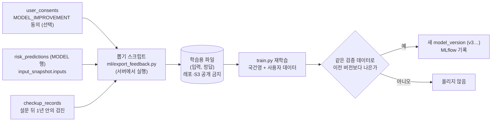

# 사용자 데이터로 재학습 (REQ-NFR-018) — 설계 초안

> 작성 최현영 · 11/26 초안, **팀 합의 전**. 담당: 학습·검증 장성은 / 서빙(수집·저장) 최현영 / 동의·ERD 김지연.
> 요구사항: 동의한 사용자의 설문 + 1년 이내 검진 수치를 학습용 (입력, 정답) 쌍으로 모으고, 쌓이면 다시 학습해서 이전 버전보다 나을 때만 올림.

## 한 줄 요약
**새 테이블 없이, 재학습할 때 기존 테이블에서 그때그때 뽑는다.**
동의 여부를 뽑는 순간에 확인하니까, 동의를 철회하면 다음 재학습부터 자동으로 빠진다.

## ① 동의 (지연님 · 가입 화면)
- `agreement_type`에 **`MODEL_IMPROVEMENT`** 추가 (선택 동의, 기존 3종과 달리 안 해도 가입됨)
- 철회는 `user_consents`에 `is_agreed=false` 행을 쌓는 기존 방식 그대로. **가장 최근 행 기준**으로 동의 여부 판단
- 동의 안 한 사람·철회한 사람은 뽑는 순간 제외 → 따로 지울 데이터가 없음

## ② 쌍 만들기 (현영 · 서빙)
| 항목 | 규칙 |
|---|---|
| 입력 | `risk_predictions`의 **MODEL 행** `input_snapshot.inputs`(변환 전)를 학습과 같은 `features.py`로 다시 변환 (#68 결정) |
| 짝 | 그 예측의 설문 시각 이후 **1년 안에 받은 검진** 중 가장 이른 것 1건 (설문 → 그 뒤 결과를 맞히는 방향) |
| 정답: 고혈압 | 수축기 ≥ 130 또는 이완기 ≥ 80 → 1, 둘 다 있고 기준 미만 → 0 (train.py와 같은 기준) |
| 정답: 당뇨 | 공복혈당 ≥ 100 또는 당화혈색소 ≥ 5.7 → 1, 공복혈당이 있고 둘 다 기준 미만 → 0 |
| 정답 수치 없음 | 그 질환 쌍은 만들지 않음 (예: 혈압만 있으면 고혈압 쌍만) |
| 중복 | 같은 설문으로 여러 번 예측한 행(검진 저장으로 다시 예측 등)은 설문 1개당 1쌍 |

## ③ 제외 (요구사항 그대로)
- 그 설문에서 진단 "예"(약 복용 포함) · 임신 · 30~69세 밖 → 원래 예측도 안 하므로 MODEL 행 자체가 없음 (5-0 plan)
- 데모 시드 계정(`demo@example.com`)·테스트 계정 제외

## ④ 재학습·비교 (성은님)
- 국건영 학습 데이터 + 사용자 쌍을 합쳐 학습, **검증은 지금과 같은 국건영 평가 세트**(층화 80/20, 시드 42)로 이전 버전과 비교
- 나을 때만 새 `model_version`으로 올림 (지금 서버는 버전이 다르면 옛 행의 건강 나이·요인을 null로 처리해서 그대로 동작)
- MLflow에 사용자 쌍 개수·뽑은 날짜·파일 sha256 기록 (원본 데이터는 기록 안 함)

## ⑤ 개인정보
- 뽑은 파일은 **서버 안에서만** 쓰고 레포·Drive·S3 공개 버킷·AI 도구에 올리지 않음 (CLAUDE.md 8장)
- 파일엔 user_id 대신 **순번**만, 이름·이메일·연락처는 애초에 안 뽑음
- 시연(데모데이)은 가상 데이터로 흐름만 보여 줌 (요구사항 비고)

## 🙋 정할 것
1. **당뇨 정답에 당화혈색소가 없을 때**: 공복혈당만 기준 미만이면 0으로 볼지 (국건영 정답은 둘 다 본 값이라, 당화혈색소가 없으면 0이 조금 많아질 수 있음) → 성은님
2. **짝 검진 고르기**: 설문 "뒤" 1년 안 검진(위 제안) vs 설문 "앞뒤" 1년 → 성은님
3. **동의 화면 위치·문구**: 가입 약관 화면에 선택 항목으로 vs 마이에서 나중에 → 지연님
4. **언제 뽑을지**: 사람이 스크립트로 (식단 데이터 갱신과 같은 방식) vs 워커 예약 작업 → 데모까지는 사람이 돌리는 걸 제안
