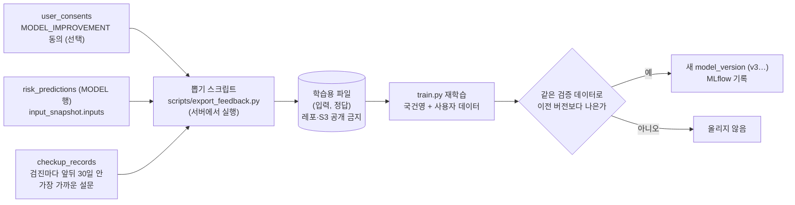

# 사용자 데이터로 재학습 (REQ-NFR-018) — 설계 초안

> 작성 최현영 · 11/26 초안, 11/27 지연·성은 의견 반영 (정할 것 1~4 모두 결정). 담당: 학습·검증 장성은 / 서빙(수집·저장) 최현영 / 동의·ERD 김지연.
> 요구사항: 동의한 사용자의 설문 + 1년 이내 검진 수치를 학습용 (입력, 정답) 쌍으로 모으고, 쌓이면 다시 학습해서 이전 버전보다 나을 때만 올림.
> → 이 설계에서 **요구사항의 "1년 이내"를 "검진 앞뒤 30일"로 좁힘** (11/27 성은, ② 짝 줄). requirements.md REQ-NFR-018 비고도 같이 고침.

## 한 줄 요약
**새 테이블 없이, 재학습할 때 기존 테이블에서 그때그때 뽑는다.**
동의 여부를 뽑는 순간에 확인하니까, 동의를 철회하면 다음 재학습부터 자동으로 빠진다.

## ① 동의 (지연님 · 가입 화면)
- `agreement_type`에 **`MODEL_IMPROVEMENT`** 추가 (선택 동의, 기존 3종과 달리 안 해도 가입됨)
- 철회는 `user_consents`에 `is_agreed=false` 행을 쌓는 기존 방식 그대로. **가장 최근 행 기준**으로 동의 여부 판단
- **동의 시각 이후에 입력한 예측 행·검진만** 씀 (검진은 검진일이 아니라 입력 시각 기준, #162 성은) → 나중에 동의한 사람의 동의 전 설문은 안 들어감 (동의 문구도 "동의한 뒤의 설문·검진" 범위로, 11/27 지연). 동의 → 철회 → 다시 동의했으면 **마지막 동의 시각 이후만**
- 화면: 가입 약관 화면에 **선택 항목(기본 체크 해제, 안 해도 가입)** + 마이에서 켜기·끄기 (철회는 어차피 마이에 있어야 함). `MODEL_IMPROVEMENT` 추가와 가입 화면 체크박스는 지연님 (11/27)
- 동의 안 한 사람·철회한 사람은 뽑는 순간 제외 → 따로 지울 데이터가 없음

## ② 쌍 만들기 (현영 · 서빙)
- 구현: `scripts/export_feedback.py` (서버 이미지엔 `ml/`·pandas가 없어서 데모 시드처럼 app 의존성만 쓰는 `scripts/`에 둠). 출력은 순번만 쓴 CSV, 로그엔 개수만
| 항목 | 규칙 |
|---|---|
| 입력 | `risk_predictions`의 **MODEL 행** `input_snapshot.inputs`(변환 전)를 학습과 같은 `features.py`로 다시 변환 (#68 결정) |
| 짝 | **검진 1건마다 가장 가까운 설문 1개** (앞뒤 30일 안, 동의 이후 MODEL 행 중). 같은 거리면 앞쪽 설문. 모델은 "지금 검사하면"을 맞히고 국건영도 설문·검진이 같은 시기라 가까운 쪽이 학습 조건과 같음. 검진 1건당 1쌍이라 주간 재설문이 같은 정답으로 여러 번 들어가지 않음. 30일은 주간 설문이라 보통 1주 안에 있어서 넉넉히 잡은 값 (11/27 성은) |
| 정답: 고혈압 | 수축기 ≥ 130 **또는** 이완기 ≥ 80 → 1 (하나만 있어도 넘으면 1). 0은 둘 다 있고 둘 다 기준 미만일 때만 (train.py와 같은 기준) |
| 정답: 당뇨 | 공복혈당 ≥ 100 **또는** 당화혈색소 ≥ 5.7 → 1 (하나만 있어도 넘으면 1). **0은 둘 다 있고 둘 다 기준 미만일 때만**. 하나만 있고 그게 정상이면 쌍 안 만듦 → 고혈압·앱 검진 기준표(5-1)와 같은 규칙 (공복혈당만 정상인 사람의 13.7%가 실제 정답 1이라 하나만 보고 0을 주지 않음, 11/27 성은 국건영 집계) |
| 정답을 못 정함 | 1도 0도 아니면 그 질환 쌍은 만들지 않음 (예: 혈압만 있으면 고혈압 쌍만, 수축기만 있고 정상이면 고혈압 쌍도 없음) |
| 중복 | 같은 설문으로 여러 번 예측한 행(검진 저장으로 다시 예측 등)은 그 설문의 첫 MODEL 행만 후보로 씀 |

## ③ 제외 (요구사항 그대로)
- 그 설문에서 진단 "예"(약 복용 포함) · 임신 · 30~69세 밖 → 원래 예측도 안 하므로 MODEL 행 자체가 없음 (5-0 plan)
- 테스트 계정: 이메일이 **`@example.com`인 계정 전부** 제외 (데모 시드 `demo@example.com` 포함, 테스트 factory도 이 도메인, 11/27 지연)

## ④ 재학습·비교 (성은님)
- 국건영 학습 데이터 + 사용자 쌍을 합쳐 학습, **검증은 지금과 같은 국건영 평가 세트**(층화 80/20, 시드 42)로 이전 버전과 비교
- 나을 때만 새 `model_version`(v3…)으로 올림. 올릴 때 바꾸기 전 JSON을 `model_files/archive/`로 옮기면 옛 행도 그 버전으로 설명됨 (#160)
- 재학습·비교는 성은님 (11/27)
- MLflow에 사용자 쌍 개수·뽑은 날짜·파일 sha256 기록 (원본 데이터는 기록 안 함)

## ⑤ 개인정보
- 뽑은 파일은 **서버 안에서만** 쓰고 레포·Drive·S3 공개 버킷·AI 도구에 올리지 않음 (CLAUDE.md 8장)
- 파일엔 user_id 대신 **순번**만, 이름·이메일·연락처는 애초에 안 뽑음
- 보관: **학습이 끝나면 바로 지움**. 남기는 건 MLflow의 쌍 개수·뽑은 날짜·sha256·지표뿐 (다시 학습할 땐 다시 뽑음, 11/27 지연)
- 시연(데모데이)은 가상 데이터로 흐름만 보여 줌 (요구사항 비고)

## 🙋 정할 것
1. ~~당뇨 정답에 당화혈색소가 없을 때~~ → ✅ 하나라도 넘으면 1, 0은 둘 다 있고 둘 다 정상일 때만 (11/27 성은, ② 표)
2. ~~짝 검진 고르기~~ → ✅ 검진 1건마다 앞뒤 30일 안 가장 가까운 설문 1개 (11/27 성은, ② 표)
3. ~~동의 화면 위치·문구~~ → ✅ 가입 화면 선택 항목 + 마이 켜기·끄기, 동의 이후 데이터만 (11/27 지연, ①)
4. ~~언제 뽑을지~~ → ✅ 데모까지는 사람이 스크립트로 (식단 데이터 갱신과 같은 방식, 11/27 지연 찬성)
