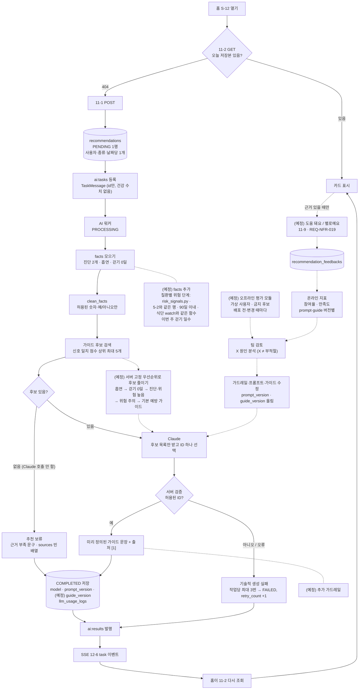
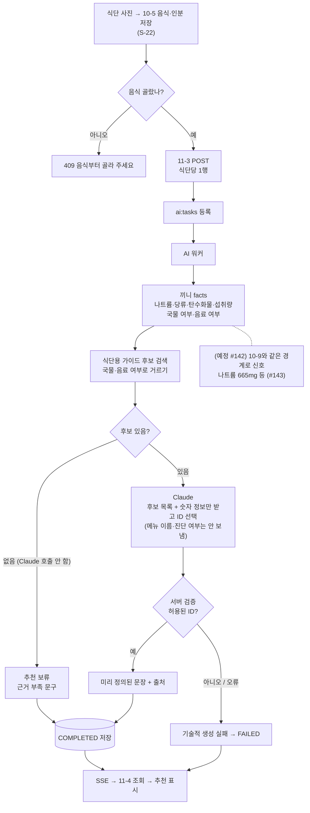
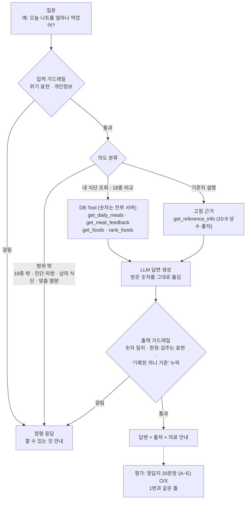

# LLM 추천 파이프라인 흐름도

> 작성 김지연 · 11/27, 김민준 확인 (develop `ai_worker/tasks/` 기준). 예측 흐름은 [prediction-pipeline.md](prediction-pipeline.md).  
> 규칙의 기준은 [api.md](api.md) 11장과 정할 것 31·32. 둘이 다르면 api.md를 따르고 이 문서를 고침.  
> 점선(`-.->`)은 아직 없는 것(구현 예정): 예측 위험 단계 facts, 서버 우선순위, 기본 예방 가이드, 추가 가드레일, 피드백(#166), 평가 모듈.

## 핵심 한 줄
**LLM이 문장을 자유롭게 쓰지 않도록 제한한 구조임.** Claude는 공인 가이드에서 뽑은 후보 중 하나의 ID만 고르고, 서버가 그 ID를 검사한 뒤 가이드에 미리 적힌 문장과 출처를 돌려줌. 그래서 의료적 환각과 부적절한 표현의 위험을 줄임.

## 1. 오늘의 한 가지 (DAILY_ACTION, REQ-LLM-001)

- input: 최신 설문(고혈압·당뇨 진단, 흡연)·이번 주 걷기 기록 → 예/아니오 facts 4개
- f(x): 신호 일치 점수로 가이드 후보 검색 → Claude는 **후보 목록만** 받고 ID 하나 선택 → 서버가 허용 ID 검사
- output: 미리 정의된 행동 문장 + 출처 번호 (`recommendations.content`·`sources`)

- 근거 부족(추천 보류)은 `COMPLETED` + `sources = []`, 기술적 실패는 `FAILED`로 따로 저장함 (11-5)

## 2. 다음 끼니에 바꿀 한 가지 (MEAL_ALTERNATIVE, REQ-LLM-002)

- input: 방금 저장한 끼니의 영양값(나트륨·당류·탄수화물)·섭취량·국물 음식 여부·음료 여부. 지금은 값이 0만 아니면 신호로 보고, 10-9와 같은 경계(나트륨 665mg 등)는 #142에서 적용 예정
- f(x): 식단용 가이드 후보 검색(국물·음료 여부로 후보 거르기) → Claude는 **후보 목록 + 숫자 정보**를 받고 ID 하나 선택 → 서버 검증
- output: 미리 정의된 "다음 끼니에 바꿀 한 가지" 문장 + 출처
- Claude에 메뉴 이름과 진단 여부는 직접 보내지 않음

## 3. 식단 챗봇 (설계 중, 담당 김민준·여현지)

- 1·2번과 달리 **LLM이 답변 문장을 직접 씀** → 질문 종류별로 갈라서 처리하고, 숫자는 전부 서버가 만듦
- input: 질문 + 내 식단 기록 (외부 LLM에 넘길 범위는 정하는 중)
- f(x): 입력 가드레일 → 의도 분류 → 내 식단 조회·18종 비교는 DB Tool, 기준치 설명은 고정 근거, 범위 밖은 정형 응답 → 답변 생성 → 출력 가드레일(숫자 일치 검사)
- output: 서버 숫자를 그대로 옮긴 답변 + 출처 + 의료 안내
- 자세한 건 여현지 "식단 챗봇 Tool 입출력 초안"·"평가 질문 20개 정답지"(11/27). 상세 설계가 확정되면 김민준이 따로 정리함

## 설명할 포인트
- LLM 추천은 자유 생성을 막고 "검증된 후보 중 선택"만 맡겨서 의료적 환각과 부적절한 표현의 위험을 줄임. 후보가 없으면 Claude를 부르지 않고 추천을 보류함
- 고혈압·당뇨 입력 라우팅은 예측 흐름도([prediction-pipeline.md](prediction-pipeline.md))에 있음. LLM 추천은 질환을 나누지 않고 facts 하나로 들어감
- "적절함"은 정답 하나가 아니라 팀 규칙 8개 + 금지 목록(가드레일)으로 정의함 (11/27 확정, 정할 것 31)
- 평가는 온라인(사용자 O/X → 참여율·만족도)과 오프라인(가상 사용자 평가 세트 → 금지 위반 0건 등 배포 전 기준)으로 나누고, 둘 다 팀 검토를 거쳐 가드레일·프롬프트·가이드를 고침. 사용자 X가 곧 부적절은 아님
- 진단 전 사용자도 추천을 받도록 예측 위험 단계를 보조 신호로 씀 (지금은 후보 0개라 추천 보류만 나옴)
- 추천과 식단 강조(watch)가 같은 위험 단계 신호를 씀 (`risk_signals.py`, 정할 것 29·31) → 홈과 식단 화면이 서로 다른 말을 하지 않음
- 예측 재학습(REQ-NFR-018)과 추천 평가(REQ-NFR-019)가 human in the loop 두 축
