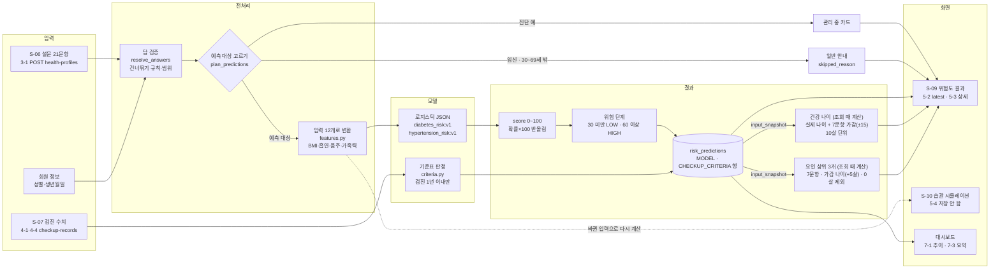

# 예측 파이프라인 흐름도 (서빙)

> 작성 최현영 · 11/25 멘토링 후속 (성은·현영). 학습 흐름은 [ml/README.md](../ml/README.md) "학습" 참고, 이 문서는 **사용자 입력이 화면까지 가는 길**만 다룸.
> 규칙의 기준은 [api.md](api.md) 5장. 둘이 다르면 api.md를 따르고 이 문서를 고침.

## 한눈에 보기

## 단계별 규칙 (요약)
| 단계 | 하는 일 | 코드 | 규칙 근거 |
|---|---|---|---|
| 입력 | 설문 저장 시 바로 예측, 최근 검진이 바뀌면(수정·삭제) 다시 예측 | `services/health_profiles.py`, `services/checkup_records.py` | api.md 3-1, 4장 |
| 검증 | 건너뛴 문항·범위 오류는 400 + `field` | `services/survey/validation.py` | api.md 3-1 |
| 대상 고르기 | 진단 "예" → 관리 중, 임신·나이 범위 밖 → 예측 안 함 | `services/prediction/plan.py` | api.md 5-0 |
| 전처리 | 설문 코드 → 모델 입력 12개 (학습과 같은 함수) | `services/prediction/features.py` | survey-mapping.md |
| 모델 | 계수·평균이 든 JSON, `model_version`·`mlflow_run_id` 같이 저장 | `services/prediction/model.py` | ml/README.md |
| 위험 단계 | 반올림한 score 기준 30/60 | `model.py` `to_level` | api.md 5-0 |
| 요인 | 조회 때 7문항 가감 나이(같은 성별 평균 기준), 0살 빼고 큰 순 3개 | `model.py` `factors` | api.md 5-0·5-3 |
| 기준표 | 검진 수치가 있으면 같은 질환에 별도 행, 1년 지나면 숨김 | `services/prediction/criteria.py`, `views.py` | api.md 5-1·5-2 |
| 화면 | "위험도 참고값", "의료 진단이 아니며 전문가 상담 필요" 안내 | 프론트 S-09·S-10 | CLAUDE.md 5장 |

## 건강 나이 (11/25 재결정)
- 곡선 방식(#102·#110) → **자가검진 7문항 + 산식**: 실제 나이 + clamp(Σ 계수 × (내 값 − 같은 성별 평균) ÷ 나이 계수, ±15) → 10살 단위. 자세한 규칙은 api.md 5-2 `health_age`
- `risk_predictions`에 저장하지 않고 5-2·5-3 조회 때 행의 `input_snapshot`으로 계산 (모델 JSON이 바뀌면 `model_version`이 같을 때만)
- 새로 학습하지 않아서 과적합 걱정이 없고, 항목별로 "+5살"처럼 설명할 수 있음 (멘토 의견: 모델링 대신 산식 + 자가검진)
