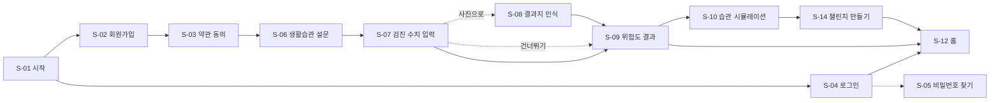

# 와이어프레임 화면 목록 (초안)

> 상태: **화면 목록 초안** — 11/18 작성, Figma는 이 목록 기준으로 그림  
> 기준: [requirements.md](requirements.md)의 `REQ-*`, 테이블은 [erd.md](erd.md)  
> 담당: 김지연  
> Figma 링크: (작성 후 추가)

## 1. 기본 방향
- 모바일 우선 PWA. 화면 폭 375px 기준으로 그리고, PC는 가운데 정렬로 같은 화면을 보여줌
- 하단 탭 5개: **홈 · 챌린지 · 기록 · 식단 · 마이**
- 우선순위
  - `P1`: 핵심 흐름(가입 설문 → 예측 → 챌린지 → 대시보드, `REQ-NFR-009`). 식단 사진 없이도 돌아가야 함
  - `P2`: 선택 기능(식단·LLM·알림)
- 예측·추천이 나오는 화면에는 "의료 진단이 아니며 전문가 상담 필요" 안내를 붙임 (`REQ-NFR-001`). 표에 ⚕️로 표시
- 짝꿍에게 보이는 건 챌린지 완료 여부뿐임 (`REQ-PAIR-003`). 짝꿍이 볼 수 있는 화면에 건강 수치·위험도를 넣지 않음

## 2. 화면 흐름

## 3. 화면 목록

### 시작·회원
| ID | 화면 | 주요 요소 | REQ | 테이블 | 우선 |
|---|---|---|---|---|---|
| S-01 | 시작 | 서비스 소개 한 줄, 가입하기·로그인 버튼 | — | — | P1 |
| S-02 | 회원가입 | 이메일, 비밀번호, 닉네임, 성별, 생년월일 | USER-001 | `users` | P1 |
| S-03 | 약관 동의 | 이용약관·개인정보·민감정보(건강정보) 각각 체크, 전체 동의, 내용 보기 | USER-005 | `user_consents` | P1 |
| S-04 | 로그인 | 이메일, 비밀번호, 비밀번호 찾기 링크 | USER-002 | `users` | P1 |
| S-05 | 비밀번호 찾기 | 이메일 입력 → 메일 발송 안내 → 링크로 새 비밀번호 입력 | USER-004 | `users` | P2 |

### 설문·예측
| ID | 화면 | 주요 요소 | REQ | 테이블 | 우선 |
|---|---|---|---|---|---|
| S-06 | 생활습관 설문 | 한 화면에 한 문항, 진행률 바, 이전·다음. 문항은 데이터팀 입력 변수 확정 후 채움 | PROF-001, PRED-004 | `health_profiles` | P1 |
| S-07 | 검진 수치 입력 | 혈압·공복혈당·허리둘레 등 직접 입력, "사진으로 입력", "건너뛰기" | PROF-002 | `checkup_records` | P1 |
| S-08 | 결과지 인식 | 사진 올리기 → 인식 중 → 원본 사진과 읽은 수치 나란히 보고 고친 뒤 저장. 이름·주민번호는 가려서 보여줌 | PROF-003, NFR-010 | `checkup_records` | P2 |
| S-09 | 위험도 결과 ⚕️ | 질환별 위험도 참고값·단계, 반영된 요인, 설문만으로는 알 수 없는 것, 요인 쉬운 말 설명, 높으면 검사 권유 | PRED-001·002, LLM-004, NFR-001·004 | `risk_predictions`, `recommendations` | P1 |
| S-10 | 습관 시뮬레이션 ⚕️ | 습관 고르기(예: 주 3회 30분 걷기) → 바뀐 위험도 미리보기 → "이걸로 챌린지 만들기" | PRED-003 | `risk_predictions` | P1 |
| S-11 | 주간 재설문 | S-06과 같은 화면을 짧게. 끝나면 S-09로 이동해 지난주와 비교 | PRED-004, NFR-003 | `health_profiles`, `risk_predictions` | P1 |

### 홈
| ID | 화면 | 주요 요소 | REQ | 테이블 | 우선 |
|---|---|---|---|---|---|
| S-12 | 홈 ⚕️ | 오늘의 한 가지(날씨 대체 활동 포함), 오늘 할 챌린지 체크, 짝꿍 완료 현황, 컨디션 선택, 알림 아이콘 | LLM-001·003, CHAL-002, PAIR-003, DASH-005 | `recommendations`, `challenge_checks`, `health_logs` | P1 |

### 챌린지·짝꿍
| ID | 화면 | 주요 요소 | REQ | 테이블 | 우선 |
|---|---|---|---|---|---|
| S-13 | 챌린지 목록 | 진행 중·끝난 챌린지, 연속 일수, 이번 주 달성 횟수, 만들기 버튼 | CHAL-003 | `challenges`, `challenge_checks` | P1 |
| S-14 | 챌린지 만들기 | 기본 목록(걷기·물·운동·스트레칭·절주)에서 고르기, 주 N회, 기간, 혼자/짝꿍과 | CHAL-001, PAIR-002 | `challenge_templates`, `challenges`, `challenge_participants` | P1 |
| S-15 | 챌린지 상세 | 달력형 완료 기록, 연속·주간 달성, 다음 주 목표 조정 제안 | CHAL-003·004 | `challenges`, `challenge_checks` | P1 |
| S-16 | 짝꿍 초대 | 초대 링크 복사·공유, 받은 초대 수락·거절, 내 짝꿍 목록 | PAIR-001 | `pairs` | P1 |
| S-17 | 짝꿍 챌린지 현황 | 서로의 완료 여부(수치 없음), 공동 달성률·배지, 응원 보내기 | PAIR-003·004 | `challenge_checks`, `cheers` | P1 |

### 기록·대시보드
| ID | 화면 | 주요 요소 | REQ | 테이블 | 우선 |
|---|---|---|---|---|---|
| S-18 | 대시보드 ⚕️ | 위험도 추이(주차별), 항목별 그래프·달성률, 챌린지·식단 요약. 고혈압·당뇨에 따라 먼저 보여줄 카드가 다름 | DASH-002·003·004 | `risk_predictions`, `health_logs`, `challenge_checks`, `meals` | P1 |
| S-19 | 건강 기록 입력 | 혈압·혈당·음주·걸음 수·컨디션 탭, 날짜·시간, 메모 | DASH-001·005 | `health_logs` | P1 |
| S-20 | 주간 리포트 ⚕️ | 이번 주 요약, 잘한 점, 다음 주 한 가지. 알림 누르면 바로 이 화면 | LLM-005, NOTI-007 | `recommendations` | P2 |

### 식단
| ID | 화면 | 주요 요소 | REQ | 테이블 | 우선 |
|---|---|---|---|---|---|
| S-21 | 식단 기록 | 날짜별 끼니 목록, 사진 올리기 버튼, 분석 중 표시 | FOOD-001 | `meals` | P2 |
| S-22 | 음식 고르기 | 후보 5개 중 선택·직접 검색, 0.5/1/1.5인분 | FOOD-001·002 | `meals`, `foods` | P2 |
| S-23 | 영양 결과 ⚕️ | 칼로리·나트륨·당류 등, 질환별 주의 항목 강조, 다음 끼니 바꿀 한 가지 | FOOD-002·003, LLM-002 | `meals`, `recommendations` | P2 |

### 알림·마이
| ID | 화면 | 주요 요소 | REQ | 테이블 | 우선 |
|---|---|---|---|---|---|
| S-24 | 알림 목록 | 종류별 아이콘, 읽음 표시, 누르면 해당 화면으로 이동 | NOTI-002·004~007 | `notifications` | P2 |
| S-25 | 알림 설정 | 종류별 켜기·요일·시간, 방해 금지 시간, 웹 푸시 켜기 버튼(누를 때만 권한 요청) | NOTI-001·003 | `notification_settings`, `push_subscriptions`, `users` | P2 |
| S-26 | 직접 만든 리마인더 | 이름·요일·시간으로 추가(최대 10개), 켜기·끄기, 삭제 | NOTI-009 | `custom_reminders` | P2 |
| S-27 | 마이 | 닉네임, 설문·검진 수치 수정, 짝꿍 관리, 알림 설정, 로그아웃, 탈퇴 | USER-003 | `users` | P1 |

### 공통 (모달·상태)
| ID | 화면 | 주요 요소 | REQ | 우선 |
|---|---|---|---|---|
| C-01 | 의료 안내 문구 | ⚕️ 화면 하단에 고정되는 안내 | NFR-001 | P1 |
| C-02 | 처리 중·실패 | 분석 중 로딩, 실패 시 다시 시도 (식단·LLM·결과지) | NFR-005 | P2 |
| C-03 | 홈 화면 추가 안내 | 아이폰에서 웹 푸시 켤 때 "홈 화면에 추가" 방법 안내 | NOTI-003 | P2 |
| C-04 | 빈 상태 | 기록·챌린지·짝꿍이 없을 때 첫 행동 안내 | NFR-007 | P1 |

> 총 27개 화면 + 공통 4개 (P1 18개 · P2 9개). `REQ-NOTI-008`(일정 기반 알림)은 보류라 화면 없음

## 4. 정할 것
- [ ] 멘토링 반영: 질환별 대시보드 구성 — S-18에서 고혈압·당뇨(·대사증후군) 사용자별로 어떤 카드를 먼저 보여줄지
- [ ] 멘토링 반영: 체중 기록 추가 여부 — 넣으면 S-19 탭과 `health_logs.log_type`에 추가
- [ ] 멘토링 반영: 1대N 챌린지 — 이지희 구조 확정 후 S-14·S-17 수정
- [ ] 위험도가 여러 질환일 때 S-09를 탭으로 나눌지, 한 화면에 카드로 쌓을지
- [ ] 식단을 하단 탭에 둘지, 기록 탭 안에 넣을지 (사진 없이도 핵심 흐름이 돌아가야 해서)
- [ ] 여현지와 식단 화면(S-21~23) 나눠 그릴지
