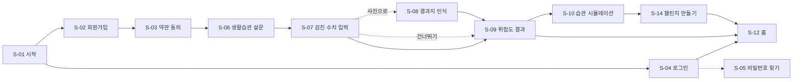

# 와이어프레임 화면 목록 (초안)

> 상태: **화면 목록 초안** — 11/18 작성, 11/19 장성은 피드백 반영(S-06·09·10·11), 11/19 API 명세·ERD 결정 반영(S-06·07·09·10·11·13~19), Figma는 이 목록 기준으로 그림  
> 기준: [requirements.md](requirements.md)의 `REQ-*`, 테이블은 [erd.md](erd.md), API는 [api.md](api.md)  
> 담당: 김지연  
> Figma 링크: [Pair 2 Care 와이어프레임](https://www.figma.com/design/MFg6KUvPm3vyVEW3Xkd88M) — 페이지 "와이어프레임 v0.1"(모바일 M·데스크톱 D 화면, 각 화면 메모에 S번호·REQ), "화면 흐름도"

## 1. 기본 방향
- 모바일 우선 PWA. 화면 폭 375px 기준으로 그리고, PC는 가운데 정렬로 같은 화면을 보여줌
- 하단 탭 5개: **홈 · 챌린지 · 짝꿍 · 기록 · 마이** (Figma BottomNav·SideNav 기준). 식단은 기록 탭 안의 "식단" 항목(M07-b)
- 우선순위
  - `P1`: 핵심 흐름(가입 설문 → 예측 → 챌린지 → 대시보드, `REQ-NFR-009`). 식단 사진 없이도 돌아가야 함
  - `P2`: 선택 기능(식단·LLM·알림)
- 예측·추천이 나오는 화면에는 "의료 진단이 아니며 전문가 상담 필요" 안내를 붙임 (`REQ-NFR-001`). 표에 ⚕️로 표시
- 짝꿍에게 보이는 건 챌린지 완료 여부뿐임 (`REQ-PAIR-003`). 짝꿍이 볼 수 있는 화면에 건강 수치·위험도를 넣지 않음

## 2. 화면 흐름

## 3. 화면 목록

### 시작·회원
| ID | 화면 | 주요 요소 | REQ | 테이블 | 우선 |
|---|---|---|---|---|---|
| S-01 | 시작 | 서비스 소개 한 줄, 가입하기·로그인 버튼 | — | — | P1 |
| S-02 | 회원가입 | 이메일, 비밀번호(칸 아래 "8자 이상, 영문+숫자", 안 맞으면 빨간 안내로 바뀜), 닉네임, 성별, 생년월일 | USER-001 | `users` | P1 |
| S-03 | 약관 동의 | 이용약관·개인정보·민감정보(건강정보) 각각 체크, 전체 동의, 내용 보기 | USER-005 | `user_consents` | P1 |
| S-04 | 로그인 | 이메일, 비밀번호, 비밀번호 찾기 링크, 실패 시 "이메일 또는 비밀번호가 맞지 않아요 (5회 틀리면 10분 잠금)" | USER-002 | `users` | P1 |
| S-05 | 비밀번호 찾기 | 이메일 입력 → 메일로 온 6자리 인증번호 입력(붙여넣기 가능, 10분 유효) → 새 비밀번호 입력 (Figma M15·M16) | USER-004 | `users` | P2 |

### 설문·예측
| ID | 화면 | 주요 요소 | REQ | 테이블 | 우선 |
|---|---|---|---|---|---|
| S-06 | 생활습관 설문 | 한 화면에 한 문항, 진행률 바, 이전·다음. 문항은 [survey-mapping.md](survey-mapping.md) 21문항(키·몸무게·허리둘레, 가족력, 음주, 흡연, 진단 여부, **임신 여부는 여성만**). 성별·나이는 회원 정보에서 가져와 안 물음. 건너뛰기 때문에 사람마다 문항 수가 다름 → 진행률은 "n/21"이 아니라 남은 문항 기준 % | PROF-001, PRED-004 | `health_profiles` | P1 |
| S-07 | 검진 수치 입력 | 검진 받은 날짜, 혈압(수축기·이완기)·공복혈당·허리둘레·중성지방·HDL 콜레스테롤 직접 입력, 당화혈색소는 "더 입력하기"로 접어 둠. 모두 선택이지만 최소 1개, 단위 표시(mmHg·mg/dL·cm·%). "사진으로 입력", "건너뛰기" | PROF-002 | `checkup_records` | P1 |
| S-08 | 결과지 인식 | 사진 올리기 → 인식 중 → 원본 사진과 읽은 수치 나란히 보고 고친 뒤 저장. 이름·주민번호는 가려서 보여줌 | PROF-003, NFR-010 | `checkup_records` | P2 |
| S-09 | 위험도 결과 ⚕️ | 질환별 카드: 위험도 참고값(모델 점수)·단계, 반영된 요인(방향만), 설문만으로는 알 수 없는 것, 요인 쉬운 말 설명. **검진 수치가 있으면** 같은 카드에 "수치가 고혈압 범위예요"처럼 기준표 판정을 따로 표시("진단" 표현 금지), 주의·높음이면 병원 확인 권유. 정상 판정은 그 질환 항목이 다 있을 때만, 빠진 항목은 "검진 수치를 더 입력하면 알 수 있어요" → 누르면 S-07의 빠진 항목 입력칸으로 바로 이동(고혈압은 수축기·이완기, 당뇨는 공복혈당·당화혈색소 중 빠진 것, 당화혈색소는 "더 입력하기"를 펼쳐서). **검진 날짜가 1년 지났으면 기준표 판정 표시 안 함**(모델 점수만, api.md 5-1). **관리 중 카드**: 진단 여부(설문 19·20번) "예"인 질환만 위험도 대신 "관리 중"(기록·챌린지로 연결). **일반 안내 상태**: 나이 30~69세 밖이거나 임신 중이면 위험도 없이 일반 건강 안내. 대사증후군: 해당 / 해당 아님 / 판단 어려움(빠진 항목 입력 유도), 유효한 검진(1년 이내) 없으면 숨김. 예측 실패 시 "다시 계산" 버튼(C-02) | PRED-001·002, LLM-004, NFR-001·004 | `risk_predictions`, `recommendations` | P1 |
| S-10 | 습관 시뮬레이션 ⚕️ | 습관 고르기 → 바뀐 위험도 미리보기(전 → 후, 저장 안 함) → "이걸로 챌린지 만들기". 고를 수 있는 건 예측 입력에 들어가는 것만: 체중(예: 3kg 감량), 음주(빈도·한 번에 마시는 양 줄이기), 흡연(금연). **나에게 해당하는 습관만 표시**(술 안 마시면 음주, 담배 안 피우면 금연 선택지 없음). 금연을 고르면 고혈압 카드에 "고혈압 위험도 점수엔 변화가 거의 없어요" 안내(흡연은 모델 입력이라 "반영 안 됨"은 틀린 말, "금연해도 소용없다"로 읽히지 않게). 걷기·운동은 위험도 계산에 안 들어가서 직접 고르지 않고, 체중 목표(예: 2kg 감량)는 사용자가 고르고, 운동은 그 목표를 위한 방법으로 함께 보여줌(운동하면 몇 kg 빠진다는 약속처럼 보이지 않게) → S-14에서 챌린지로. 진단 "예"·임신·나이 범위 밖 질환은 빠짐 | PRED-003 | `risk_predictions` | P1 |
| S-11 | 주간 재설문 | S-06과 같은 화면을 짧게(survey-mapping.md "재설문: 물음" 문항만). 이어서 **주간 기록 6종**(걷기·근력운동 일수, 앉아 있는 시간, 수면 주중·주말, 아침식사, 스트레스) — 모두 선택, 예측엔 안 쓰고 그 주 월요일 기준 1행 저장. 끝나면 S-09로 이동해 지난주와 비교("낮아졌어요"는 점수가 실제로 내려갔을 때만, 바뀐 입력값과 함께) | PRED-004, NFR-003, DASH-001 | `health_profiles`, `risk_predictions`, `health_logs` | P1 |

### 홈
| ID | 화면 | 주요 요소 | REQ | 테이블 | 우선 |
|---|---|---|---|---|---|
| S-12 | 홈 ⚕️ | 오늘의 한 가지(날씨 대체 활동 포함), 오늘 할 챌린지 체크, 짝꿍 완료 현황, 컨디션 선택, 알림 아이콘 | LLM-001·003, CHAL-002, PAIR-003, DASH-005 | `recommendations`, `challenge_checks`, `health_logs` | P1 |

### 챌린지·짝꿍
| ID | 화면 | 주요 요소 | REQ | 테이블 | 우선 |
|---|---|---|---|---|---|
| S-13 | 챌린지 목록 | 진행 중·끝난 챌린지, 이번 주 달성 횟수·누적, 연속 주(목표 채운 주), 오늘 체크 여부, 짝꿍이 빠진 1:1 챌린지는 "계속할지 골라 주세요" 표시, 만들기 버튼 | CHAL-003 | `challenges`, `challenge_checks`, `challenge_participants` | P1 |
| S-14 | 챌린지 만들기 | 기본 목록(걷기·물·운동·스트레칭·절주·체중·금연)에서 고르기 또는 직접 만들기, 제목, 주 N회(−/+), 시작일·기간(기한 없음 가능), 혼자 / 짝꿍 1명 / 짝꿍 여러 명(내 짝꿍 중 1~3명, 나 포함 최대 4명, 1:N은 12/4 이후) | CHAL-001, PAIR-002 | `challenge_templates`, `challenges`, `challenge_participants` | P1 |
| S-15 | 챌린지 상세 | 달력형 완료 기록, 이번 주 N회·누적(먼저) → 연속 주(아래, 목표 채운 주 기준), 체크 버튼(오늘·어제만, 잘못 누르면 취소), 다음 주 목표 조정 제안(규칙형, P2), 내 목표 횟수 바꾸기(다음 주부터). 메뉴: 나가기 / **1:N 호스트만** 수정·짝꿍 추가 초대·끝내기(혼자 남았을 때만). 1:N 호스트가 나가면 넘길 사람 고르기(안 고르면 먼저 들어온 사람) → "이제 ○○님이 호스트예요". **1:1은 호스트 표시 없음**, 상대가 빠지면 "종료 / 혼자 계속" 고르기 전까지 체크 막음 | CHAL-003·004 | `challenges`, `challenge_checks`, `challenge_participants` | P1 |
| S-16 | 짝꿍 초대 | 초대 링크 만들기·복사·공유(7일 지나면 만료), 보낸 초대 목록·취소, 초대 링크를 연 사람에게 "○○님이 짝꿍 초대를 보냈어요" → 수락(거절은 따로 없이 무시), 이미 쓴·만료된 링크 안내, 내 짝꿍 목록·끊기 | PAIR-001 | `pairs` | P1 |
| S-17 | 짝꿍 챌린지 현황 | 서로의 완료 여부(닉네임·날짜별 체크만, 수치 없음, P1), 함께 채운 칸·사람별 채운 칸(●●○, 목표 넘긴 체크는 안 셈)·배지·응원(같은 사람에게 하루 1번, P2). 순위·막대 비교 없음, 1:1은 호스트 표시 없음 | PAIR-003·004 | `challenge_checks`, `challenge_participants`, `cheers` | P1 |

### 기록·대시보드
| ID | 화면 | 주요 요소 | REQ | 테이블 | 우선 |
|---|---|---|---|---|---|
| S-18 | 대시보드 ⚕️ | 위험도 추이(주차별, 모델 점수만 선으로 잇고 검진 기준표 판정은 그 주에 표시만), "관리 중" 질환은 추이 대신 카드, 항목별 그래프(혈압은 집에서 잰 값만, 일·주 평균)·달성률, 챌린지·식단 요약. 고혈압·당뇨에 따라 먼저 보여줄 카드가 다름 | DASH-002·003·004 | `risk_predictions`, `health_logs`, `challenge_checks`, `meals` | P1 |
| S-19 | 건강 기록 입력 | 혈압(수축기·이완기)·혈당·음주(잔)·운동(분)·걸음 수·컨디션(좋음·보통·나쁨)·**체중** 탭, 날짜·시간(생략하면 지금), 메모. 걸음 수·컨디션은 하루 1번(다시 입력하면 덮어씀) | DASH-001·005 | `health_logs` | P1 |
| S-20 | 주간 리포트 ⚕️ | 이번 주 요약, 잘한 점, 다음 주 한 가지. 알림 누르면 바로 이 화면 | LLM-005, NOTI-007 | `recommendations` | P2 |

### 식단
| ID | 화면 | 주요 요소 | REQ | 테이블 | 우선 |
|---|---|---|---|---|---|
| S-21 | 식단 기록 | 날짜별 끼니 목록(사진 썸네일·음식명·칼로리), 사진 올리기 버튼(촬영·앨범), 분석 중 표시(`PENDING`·`PROCESSING`), 실패 시 다시 시도·직접 고르기(`FAILED`, C-02) | FOOD-001 | `meals` | P2 |
| S-22 | 음식 고르기 | 올린 사진, 후보 5개(확률 높은 순, 첫 번째 미리 선택) 중 선택, "목록에 없어요" → 직접 검색, 0.5/1/1.5인분(기본 1인분, 1인분 중량 g·mL 함께 표시) | FOOD-001·002 | `meals`, `foods` | P2 |
| S-23 | 영양 결과 ⚕️ | 칼로리·탄수화물·당류·나트륨·단백질·지방(먹은 양 기준), 질환별 주의 항목 강조(고혈압 → 나트륨, 당뇨 → 당류·탄수화물), 값이 없는 항목은 "정보 없음", 출처 "식약처 식품영양성분DB", 다음 끼니 바꿀 한 가지 | FOOD-002·003, LLM-002 | `meals`, `recommendations` | P2 |

### 알림·마이
| ID | 화면 | 주요 요소 | REQ | 테이블 | 우선 |
|---|---|---|---|---|---|
| S-24 | 알림 목록 | 종류별 아이콘, 읽음 표시, 누르면 해당 화면으로 이동 | NOTI-002·004~007 | `notifications` | P2 |
| S-25 | 알림 설정 | 종류별 켜기·요일·시간, 방해 금지 시간, 웹 푸시 켜기 버튼(누를 때만 권한 요청) | NOTI-001·003 | `notification_settings`, `push_subscriptions`, `users` | P2 |
| S-26 | 직접 만든 리마인더 | 이름·요일·시간으로 추가(최대 10개), 켜기·끄기, 삭제 | NOTI-009 | `custom_reminders` | P2 |
| S-27 | 마이 | 닉네임, 설문·검진 수치 수정, 짝꿍 관리, 알림 설정, 로그아웃, 탈퇴 | USER-003 | `users` | P1 |

### 공통 (모달·상태)
| ID | 화면 | 주요 요소 | REQ | 우선 |
|---|---|---|---|---|
| C-01 | 의료 안내 문구 | ⚕️ 화면 하단에 고정되는 안내 | NFR-001 | P1 |
| C-02 | 처리 중·실패 | 분석 중 로딩, 실패 시 다시 시도 (식단·LLM·결과지) | NFR-005 | P2 |
| C-03 | 홈 화면 추가 안내 | 아이폰에서 웹 푸시 켤 때 "홈 화면에 추가" 방법 안내 | NOTI-003 | P2 |
| C-04 | 빈 상태 | 기록·챌린지·짝꿍이 없을 때 첫 행동 안내 | NFR-007 | P1 |

> 총 27개 화면 + 공통 4개 (P1 18개 · P2 9개). `REQ-NOTI-008`(일정 기반 알림)은 보류라 화면 없음

## 4. 정할 것
- [ ] 멘토링 반영: 질환별 대시보드 구성 — S-18에서 고혈압·당뇨(·대사증후군) 사용자별로 어떤 카드를 먼저 보여줄지
- [x] 멘토링 반영: 체중 기록 추가 — S-19 체중 탭, `health_logs.log_type` WEIGHT (11/19 API 명세)
- [x] 멘토링 반영: 1대N 챌린지 — 11/19 안 A로 확정, S-14·S-15·S-17 반영
- [x] S-14 기본 목록에 체중·금연 추가 (11/19 확정)
- [x] 챌린지 관리하는 사람 용어는 "호스트" (방장·리더 대신, 짝꿍 사이에 위아래가 생기지 않게). 1:1은 화면에 표시 안 함 (11/19 #34)
- [x] 위험도가 여러 질환일 때 S-09는 한 화면에 질환별 카드로 쌓음 (Figma M04, 11/19)
- [x] 식단은 하단 탭이 아니라 기록 탭 안에 둠 (Figma M07-b, 사진 없이도 핵심 흐름이 돌아가야 해서). 홈에서도 "오늘 식단 기록하기"로 들어감
- [ ] 여현지와 식단 화면(S-21~23) 나눠 그릴지
