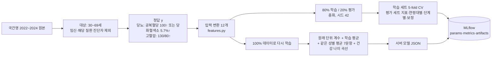
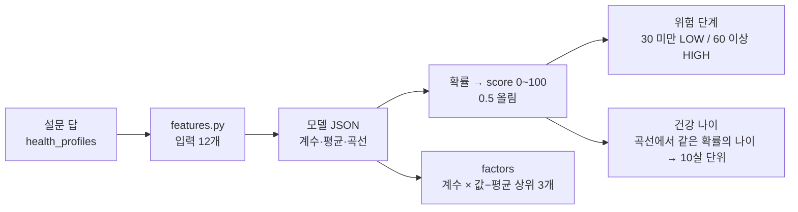

# ml — 예측 모델 학습·검증

고혈압·당뇨 위험 예측 모델(로지스틱 회귀)을 학습·검증하고 서버용 모델 JSON을 만드는 코드.
담당: 학습·검증 장성은 / 서빙 구현 최현영 (docs/team.md). 명세는 docs/api.md 5장.

## 원본 데이터 규칙 (꼭 지키기)
- 국민건강영양조사 원본(.sas7bdat 등)과 거기서 뽑은 개별 자료는 **레포·클라우드·AI·팀원 공유 금지** (이용 서약)
- 원본은 레포 밖 각자 PC에 두고, 위치는 `envs/.local.env`의 `KNHANES_DIR`로 받음 (코드에 경로 직접 쓰지 않기)
- 출력·로그·MLflow에는 집계 숫자·모델 지표·계수만. 데이터 행은 남기지 않음
- 노트북(실험)은 레포에 올리지 않고, 확정 코드만 .py로

## 파일
| 파일 | 하는 일 |
|---|---|
| train.py | 원본 불러오기 → 대상·정답 → 입력 변환 → 평가 → 100% 재학습 → 서버 JSON + MLflow 기록 |
| evaluate.py | AUROC·AUPRC·Brier·보정 기울기, 연령대별 AUROC, 위험 단계(30/60)별 비율·Recall·Precision, 계수 부호 확인 |
| serving_json.py | 원래 단위 계수 → 서버 모델 JSON, 같은 성별 평균(건강 나이·요인 7문항), 건강 나이 곡선 계산·검사 (표준 라이브러리만, CI 테스트) |

- 입력 변환은 서빙과 같은 `app/services/prediction/features.py`를 씀 (학습·서빙 어긋남 방지)
- 테스트: `app/tests/ml_training/` (가상 데이터만)

## 실행
레포 루트에서 (원본 위치는 `envs/.local.env`의 `KNHANES_DIR`):
```
uv run --env-file envs/.local.env --group ml python -m ml.train
```
- 결과 JSON은 MLflow artifacts(`mlruns/`, git에 안 올라감)에 저장. `--out-dir 폴더`를 주면 그 폴더에도 저장
- MLflow 화면: `uv run --group ml mlflow ui --backend-store-uri sqlite:///mlruns/mlflow.db` → http://127.0.0.1:5000
- 레포의 `app/services/prediction/model_files/` 교체는 결과를 확인한 뒤 따로 PR

## 입력 → 출력 흐름
모델: 설문 답 X → f(X) = sigmoid(절편 + Σ 계수 × 입력) → Y = 위험도 참고값 0~100 (진단 아님)

### 학습


### 서빙 (app/services/prediction)


## 기준
- 데이터: 국민건강영양조사 2022~2024, 30~69세, 해당 질환 진단자·임신부 제외
- 정답: 당뇨 공복혈당 100↑ 또는 당화혈색소 5.7%↑ / 고혈압 130/80↑
- 모델: 로지스틱 회귀(표준화, C=1). XGBoost와 비교했을 때 차이가 CV 표준편차 이하라 로지스틱으로 확정 (11/24)
- 평가 수치는 80/20 평가 세트 결과로 보고. 서버에 넣는 모델은 100% 데이터로 다시 학습한 것 (100% 모델로 평가 세트를 다시 재지 않음)
- 계수 방향이 진료지침과 반대(나이·bmi·음주·해당 질환 가족력은 +, 흡연은 0 이상)면 JSON을 만들지 않고 멈춤
- 재현: 분할·CV 시드 42 고정, MLflow에 파라미터·원본 파일 해시·지표 기록
- 자세한 근거: docs/survey-mapping.md, docs/variables.md, docs/api.md 5장

